# umwelt results (main)

Worlds: ghost, impermanent, lawful, lawful_mj, nonlocal. Seeds: 0, 1. Minds per world: 14, 14, 14, 14, 14, 14.

## Preregistered checks

| check | verdict | numbers |
|---|---|---|
| V1 oracle is the ceiling | PASS | exceeded by: none |
| V2 trained beats untrained on 5+ concepts | PASS | fails: none |
| V3 untrained minds show no surprise | FAIL | surprised: dog/causality, oracle/permanence |
| V3 excluding the oracle (not preregistered: the oracle sees the hidden event directly) | FAIL | surprised: dog/causality |
| H1 permanence needs memory | FAIL | human 0.18, memoryless 0.18, raw 0.17 |
| H2 smell lives in the past | FAIL | past bias smell -0.003, vision -0.000; smell_only object_now 0.05, so a near-zero bias may be noise |
| H3 Held and Hein: efference shapes self, not objects | FAIL | self_location human 0.49 vs passive_novest 0.49; self_motion 0.88 vs 0.53; object_seen human 0.58 vs passive 0.58 |
| H4 counting needs a sense that separates objects | FAIL | vision_only -0.00, bat 0.08, smell_only 0.06, hearing_only 0.02 |
| H5 translation runs from richer to poorer minds | PASS | human->blind 0.74 vs blind->human 0.37; human->vision_only 0.88 vs vision_only->human 0.77; dog->smell_only 0.82 vs smell_only->dog 0.20 |
| H6 surprise at impossible permanence | FAIL | interval above 0 for none; memoryless null False; share of minds less surprised after impermanent training 0.62 |
| H7 world forces permanence and cause; the mind decides seeing, counting, self-motion | FAIL | object_hidden mind 0.95 world 0.04; cause mind 0.23 world 0.74; object_seen mind 0.96 world 0.03; number mind 0.87 world 0.05; self_motion mind 0.99 world 0.01 |

## Audit: the same checks in the independent MuJoCo engine

| check | verdict | numbers |
|---|---|---|
| V1 oracle is the ceiling | PASS | exceeded by: none |
| V2 trained beats untrained on 5+ concepts | PASS | fails: none |
| V3 untrained minds show no surprise | FAIL | surprised: dog/causality, oracle/permanence |
| V3 excluding the oracle (not preregistered: the oracle sees the hidden event directly) | FAIL | surprised: dog/causality |
| H1 permanence needs memory | FAIL | human 0.17, memoryless 0.17, raw 0.15 |
| H2 smell lives in the past | PASS | past bias smell 0.002, vision -0.004; smell_only object_now 0.05, so a near-zero bias may be noise |
| H3 Held and Hein: efference shapes self, not objects | FAIL | self_location human 0.50 vs passive_novest 0.51; self_motion 0.89 vs 0.52; object_seen human 0.57 vs passive 0.57 |
| H4 counting needs a sense that separates objects | FAIL | vision_only -0.02, bat 0.03, smell_only 0.00, hearing_only 0.04 |
| H5 translation runs from richer to poorer minds | PASS | human->blind 0.74 vs blind->human 0.32; human->vision_only 0.89 vs vision_only->human 0.81; dog->smell_only 0.82 vs smell_only->dog 0.22 |
| H6 surprise at impossible permanence | FAIL | interval above 0 for none; memoryless null True; share of minds less surprised after impermanent training n/a |

Agreement between engines, lawful world: Pearson r = 0.998 over 168 mind-concept scores (mostly driven by differences between minds); mean absolute difference 0.017, largest 0.117.

## ghost world: probe scores (MLP probe; untrained / raw senses / linear probe in brackets)

| mind | object_seen | object_hidden | object_now | object_past | object_allo_seen | object_allo_hidden | number | self_motion | self_location | cause | elapsed | relations |
|---|---|---|---|---|---|---|---|---|---|---|---|---|
| oracle | 0.97 [n/a / n/a / 0.33] | 0.96 [n/a / n/a / -0.13] | 0.97 [n/a / n/a / 0.03] | 0.96 [n/a / n/a / 0.03] | 0.98 [n/a / n/a / 0.99] | 0.98 [n/a / n/a / 0.99] | 0.92 [n/a / n/a / 0.90] | 0.67 [n/a / n/a / 0.13] | 0.99 [n/a / n/a / 0.99] | n/a [n/a / n/a / n/a] | 0.01 [n/a / n/a / -0.01] | 0.16 [n/a / n/a / 0.16] |
| human | 0.55 [n/a / n/a / 0.48] | 0.21 [n/a / n/a / 0.19] | 0.33 [n/a / n/a / 0.29] | 0.33 [n/a / n/a / 0.29] | 0.00 [n/a / n/a / 0.02] | -0.08 [n/a / n/a / -0.03] | 0.02 [n/a / n/a / -0.00] | 0.90 [n/a / n/a / 0.81] | 0.47 [n/a / n/a / 0.06] | n/a [n/a / n/a / n/a] | 0.16 [n/a / n/a / 0.17] | -0.01 [n/a / n/a / -0.01] |
| dog | 0.51 [n/a / n/a / 0.46] | 0.26 [n/a / n/a / 0.21] | 0.35 [n/a / n/a / 0.30] | 0.34 [n/a / n/a / 0.30] | 0.00 [n/a / n/a / 0.02] | -0.08 [n/a / n/a / -0.03] | 0.00 [n/a / n/a / 0.01] | 0.89 [n/a / n/a / 0.77] | 0.27 [n/a / n/a / 0.05] | n/a [n/a / n/a / n/a] | 0.21 [n/a / n/a / 0.20] | -0.00 [n/a / n/a / 0.00] |
| vision_only | 0.56 [n/a / n/a / 0.49] | 0.21 [n/a / n/a / 0.20] | 0.33 [n/a / n/a / 0.30] | 0.33 [n/a / n/a / 0.30] | 0.01 [n/a / n/a / 0.02] | -0.08 [n/a / n/a / -0.03] | -0.00 [n/a / n/a / 0.00] | 0.74 [n/a / n/a / 0.62] | 0.52 [n/a / n/a / 0.10] | n/a [n/a / n/a / n/a] | 0.08 [n/a / n/a / 0.10] | -0.01 [n/a / n/a / -0.00] |
| bat | 0.49 [n/a / n/a / 0.47] | 0.17 [n/a / n/a / 0.10] | 0.28 [n/a / n/a / 0.23] | 0.28 [n/a / n/a / 0.23] | -0.02 [n/a / n/a / 0.02] | -0.08 [n/a / n/a / -0.03] | 0.06 [n/a / n/a / 0.06] | 0.92 [n/a / n/a / 0.83] | -0.03 [n/a / n/a / -0.00] | n/a [n/a / n/a / n/a] | 0.19 [n/a / n/a / 0.18] | 0.01 [n/a / n/a / 0.02] |
| chimera | 0.49 [n/a / n/a / 0.49] | 0.19 [n/a / n/a / 0.08] | 0.30 [n/a / n/a / 0.22] | 0.30 [n/a / n/a / 0.22] | 0.03 [n/a / n/a / 0.03] | -0.09 [n/a / n/a / -0.04] | 0.06 [n/a / n/a / 0.06] | 0.79 [n/a / n/a / 0.69] | 0.63 [n/a / n/a / 0.02] | n/a [n/a / n/a / n/a] | 0.18 [n/a / n/a / 0.18] | 0.01 [n/a / n/a / 0.02] |
| blind | 0.36 [n/a / n/a / 0.35] | -0.14 [n/a / n/a / -0.15] | 0.03 [n/a / n/a / 0.03] | 0.03 [n/a / n/a / 0.03] | -0.00 [n/a / n/a / 0.02] | -0.07 [n/a / n/a / -0.04] | 0.03 [n/a / n/a / 0.02] | 0.93 [n/a / n/a / 0.79] | -0.03 [n/a / n/a / -0.01] | n/a [n/a / n/a / n/a] | 0.18 [n/a / n/a / 0.18] | 0.00 [n/a / n/a / -0.00] |
| hearing_only | 0.37 [n/a / n/a / 0.36] | -0.06 [n/a / n/a / -0.10] | 0.09 [n/a / n/a / 0.06] | 0.08 [n/a / n/a / 0.06] | 0.01 [n/a / n/a / 0.02] | -0.06 [n/a / n/a / -0.04] | 0.06 [n/a / n/a / 0.05] | 0.90 [n/a / n/a / 0.79] | -0.02 [n/a / n/a / -0.01] | n/a [n/a / n/a / n/a] | 0.18 [n/a / n/a / 0.18] | 0.02 [n/a / n/a / 0.02] |
| smell_only | 0.36 [n/a / n/a / 0.34] | -0.14 [n/a / n/a / -0.14] | 0.04 [n/a / n/a / 0.03] | 0.04 [n/a / n/a / 0.04] | 0.00 [n/a / n/a / 0.01] | -0.05 [n/a / n/a / -0.05] | 0.07 [n/a / n/a / 0.05] | 0.77 [n/a / n/a / 0.58] | -0.01 [n/a / n/a / -0.00] | n/a [n/a / n/a / n/a] | 0.14 [n/a / n/a / 0.13] | 0.05 [n/a / n/a / 0.05] |
| deafblind | 0.32 [n/a / n/a / 0.34] | -0.14 [n/a / n/a / -0.16] | 0.02 [n/a / n/a / 0.02] | 0.02 [n/a / n/a / 0.02] | -0.00 [n/a / n/a / 0.02] | -0.06 [n/a / n/a / -0.04] | -0.02 [n/a / n/a / -0.02] | 0.94 [n/a / n/a / 0.80] | -0.03 [n/a / n/a / -0.01] | n/a [n/a / n/a / n/a] | 0.17 [n/a / n/a / 0.17] | -0.03 [n/a / n/a / -0.01] |
| touch_only | 0.34 [n/a / n/a / 0.35] | -0.14 [n/a / n/a / -0.15] | 0.03 [n/a / n/a / 0.02] | 0.02 [n/a / n/a / 0.02] | 0.00 [n/a / n/a / 0.02] | -0.06 [n/a / n/a / -0.04] | -0.06 [n/a / n/a / -0.07] | 0.95 [n/a / n/a / 0.85] | -0.03 [n/a / n/a / -0.01] | n/a [n/a / n/a / n/a] | 0.15 [n/a / n/a / 0.14] | -0.04 [n/a / n/a / -0.01] |
| passive | 0.55 [n/a / n/a / 0.47] | 0.22 [n/a / n/a / 0.19] | 0.33 [n/a / n/a / 0.29] | 0.33 [n/a / n/a / 0.29] | 0.00 [n/a / n/a / 0.02] | -0.08 [n/a / n/a / -0.03] | 0.01 [n/a / n/a / 0.00] | 0.92 [n/a / n/a / 0.83] | 0.45 [n/a / n/a / 0.07] | n/a [n/a / n/a / n/a] | 0.15 [n/a / n/a / 0.16] | -0.02 [n/a / n/a / -0.00] |
| passive_novest | 0.56 [n/a / n/a / 0.49] | 0.22 [n/a / n/a / 0.19] | 0.34 [n/a / n/a / 0.30] | 0.34 [n/a / n/a / 0.30] | 0.01 [n/a / n/a / 0.02] | -0.10 [n/a / n/a / -0.03] | 0.01 [n/a / n/a / -0.01] | 0.57 [n/a / n/a / 0.32] | 0.48 [n/a / n/a / 0.08] | n/a [n/a / n/a / n/a] | 0.13 [n/a / n/a / 0.13] | -0.01 [n/a / n/a / -0.00] |
| memoryless | 0.55 [n/a / n/a / 0.48] | 0.21 [n/a / n/a / 0.19] | 0.33 [n/a / n/a / 0.29] | 0.33 [n/a / n/a / 0.29] | 0.01 [n/a / n/a / 0.02] | -0.09 [n/a / n/a / -0.03] | 0.01 [n/a / n/a / -0.00] | 0.85 [n/a / n/a / 0.76] | 0.49 [n/a / n/a / 0.07] | n/a [n/a / n/a / n/a] | 0.13 [n/a / n/a / 0.14] | -0.01 [n/a / n/a / -0.00] |

### ghost world: surprise at impossible events (S, 95% interval; copy-baseline S)

| mind | permanence | solidity | causality |
|---|---|---|---|
| oracle | 0.130 [0.113, 0.147] (432.570) | 0.037 [-0.004, 0.084] (0.000) | -0.003 [-0.005, -0.000] (0.000) |
| human | 0.005 [0.001, 0.008] (0.007) | 0.001 [-0.003, 0.004] (-0.002) | -0.078 [-0.130, -0.026] (0.001) |
| dog | 0.000 [-0.008, 0.009] (0.005) | -0.005 [-0.010, 0.002] (-0.002) | 0.009 [-0.014, 0.030] (-0.002) |
| vision_only | 0.001 [-0.002, 0.004] (0.006) | 0.003 [-0.000, 0.005] (-0.000) | -0.071 [-0.125, -0.019] (0.004) |
| bat | -0.002 [-0.009, 0.005] (-0.008) | -0.009 [-0.015, -0.004] (0.000) | -0.108 [-0.126, -0.089] (-0.005) |
| chimera | 0.007 [0.000, 0.012] (0.003) | -0.003 [-0.009, 0.002] (-0.003) | -0.111 [-0.130, -0.092] (-0.011) |
| blind | -0.016 [-0.047, 0.022] (-0.016) | -0.007 [-0.038, 0.027] (0.001) | 0.007 [-0.025, 0.036] (-0.001) |
| hearing_only | 0.007 [-0.051, 0.062] (0.023) | 0.004 [-0.014, 0.014] (-0.003) | -0.008 [-0.025, 0.012] (0.002) |
| smell_only | 0.027 [-0.013, 0.068] (0.051) | -0.006 [-0.037, 0.022] (-0.001) | 0.009 [-0.030, 0.049] (0.005) |
| deafblind | 0.003 [-0.030, 0.037] (0.002) | 0.002 [-0.032, 0.052] (0.036) | 0.007 [-0.028, 0.038] (-0.022) |
| touch_only | 0.003 [-0.020, 0.027] (-0.000) | -0.005 [-0.037, 0.025] (-0.016) | -0.012 [-0.034, 0.014] (-0.013) |
| passive | 0.001 [-0.004, 0.005] (-0.003) | -0.001 [-0.004, 0.002] (-0.003) | -0.077 [-0.129, -0.027] (0.006) |
| passive_novest | -0.002 [-0.006, 0.002] (-0.017) | 0.002 [-0.004, 0.007] (-0.000) | -0.068 [-0.120, -0.016] (-0.007) |
| memoryless | 0.004 [-0.001, 0.008] (0.008) | 0.003 [-0.001, 0.008] (0.006) | -0.067 [-0.117, -0.017] (-0.001) |

## impermanent world: probe scores (MLP probe; untrained / raw senses / linear probe in brackets)

| mind | object_seen | object_hidden | object_now | object_past | object_allo_seen | object_allo_hidden | number | self_motion | self_location | cause | elapsed | relations |
|---|---|---|---|---|---|---|---|---|---|---|---|---|
| oracle | 0.97 [n/a / n/a / 0.36] | 0.96 [n/a / n/a / -0.17] | 0.96 [n/a / n/a / 0.03] | 0.76 [n/a / n/a / 0.02] | 0.98 [n/a / n/a / 0.98] | 0.98 [n/a / n/a / 0.98] | 0.98 [n/a / n/a / 0.94] | 0.53 [n/a / n/a / 0.12] | 0.99 [n/a / n/a / 0.99] | 0.37 [n/a / n/a / 0.30] | -0.03 [n/a / n/a / -0.00] | 0.40 [n/a / n/a / 0.15] |
| human | 0.60 [n/a / n/a / 0.51] | 0.26 [n/a / n/a / 0.25] | 0.39 [n/a / n/a / 0.35] | 0.36 [n/a / n/a / 0.33] | -0.01 [n/a / n/a / -0.01] | -0.06 [n/a / n/a / -0.01] | 0.02 [n/a / n/a / 0.02] | 0.89 [n/a / n/a / 0.80] | 0.50 [n/a / n/a / 0.06] | 0.51 [n/a / n/a / 0.51] | 0.07 [n/a / n/a / 0.09] | -0.01 [n/a / n/a / -0.00] |
| dog | 0.55 [n/a / n/a / 0.49] | 0.30 [n/a / n/a / 0.28] | 0.39 [n/a / n/a / 0.36] | 0.38 [n/a / n/a / 0.35] | -0.02 [n/a / n/a / -0.01] | -0.06 [n/a / n/a / -0.01] | 0.04 [n/a / n/a / 0.05] | 0.88 [n/a / n/a / 0.78] | 0.33 [n/a / n/a / 0.05] | 0.62 [n/a / n/a / 0.61] | 0.12 [n/a / n/a / 0.12] | 0.00 [n/a / n/a / 0.01] |
| vision_only | 0.60 [n/a / n/a / 0.52] | 0.27 [n/a / n/a / 0.26] | 0.40 [n/a / n/a / 0.36] | 0.36 [n/a / n/a / 0.34] | -0.01 [n/a / n/a / -0.01] | -0.05 [n/a / n/a / -0.01] | 0.01 [n/a / n/a / 0.01] | 0.73 [n/a / n/a / 0.61] | 0.54 [n/a / n/a / 0.08] | 0.48 [n/a / n/a / 0.44] | 0.04 [n/a / n/a / 0.07] | -0.01 [n/a / n/a / -0.01] |
| bat | 0.53 [n/a / n/a / 0.51] | 0.22 [n/a / n/a / 0.11] | 0.34 [n/a / n/a / 0.26] | 0.30 [n/a / n/a / 0.25] | -0.04 [n/a / n/a / -0.01] | -0.04 [n/a / n/a / -0.01] | 0.08 [n/a / n/a / 0.09] | 0.90 [n/a / n/a / 0.80] | -0.04 [n/a / n/a / -0.01] | 0.45 [n/a / n/a / 0.42] | 0.09 [n/a / n/a / 0.10] | 0.01 [n/a / n/a / 0.02] |
| chimera | 0.54 [n/a / n/a / 0.53] | 0.24 [n/a / n/a / 0.10] | 0.35 [n/a / n/a / 0.26] | 0.33 [n/a / n/a / 0.24] | 0.05 [n/a / n/a / -0.00] | -0.06 [n/a / n/a / -0.01] | 0.09 [n/a / n/a / 0.09] | 0.73 [n/a / n/a / 0.63] | 0.65 [n/a / n/a / 0.03] | 0.59 [n/a / n/a / 0.58] | 0.09 [n/a / n/a / 0.11] | 0.02 [n/a / n/a / 0.02] |
| blind | 0.41 [n/a / n/a / 0.41] | -0.15 [n/a / n/a / -0.17] | 0.06 [n/a / n/a / 0.04] | 0.04 [n/a / n/a / 0.03] | -0.04 [n/a / n/a / -0.01] | -0.03 [n/a / n/a / -0.01] | 0.04 [n/a / n/a / 0.05] | 0.94 [n/a / n/a / 0.82] | -0.04 [n/a / n/a / -0.01] | 0.61 [n/a / n/a / 0.60] | 0.09 [n/a / n/a / 0.11] | -0.00 [n/a / n/a / 0.00] |
| hearing_only | 0.44 [n/a / n/a / 0.42] | -0.09 [n/a / n/a / -0.12] | 0.11 [n/a / n/a / 0.08] | 0.09 [n/a / n/a / 0.07] | -0.03 [n/a / n/a / -0.01] | -0.03 [n/a / n/a / -0.02] | 0.02 [n/a / n/a / 0.03] | 0.89 [n/a / n/a / 0.77] | -0.03 [n/a / n/a / -0.01] | 0.55 [n/a / n/a / 0.54] | 0.11 [n/a / n/a / 0.11] | -0.01 [n/a / n/a / 0.00] |
| smell_only | 0.40 [n/a / n/a / 0.40] | -0.16 [n/a / n/a / -0.17] | 0.05 [n/a / n/a / 0.04] | 0.05 [n/a / n/a / 0.04] | -0.03 [n/a / n/a / -0.01] | -0.03 [n/a / n/a / -0.01] | 0.12 [n/a / n/a / 0.10] | 0.73 [n/a / n/a / 0.52] | -0.03 [n/a / n/a / -0.01] | 0.69 [n/a / n/a / 0.66] | 0.08 [n/a / n/a / 0.07] | 0.06 [n/a / n/a / 0.05] |
| deafblind | 0.40 [n/a / n/a / 0.41] | -0.16 [n/a / n/a / -0.17] | 0.05 [n/a / n/a / 0.04] | 0.04 [n/a / n/a / 0.04] | -0.03 [n/a / n/a / -0.01] | -0.03 [n/a / n/a / -0.01] | 0.01 [n/a / n/a / 0.00] | 0.95 [n/a / n/a / 0.85] | -0.03 [n/a / n/a / -0.01] | 0.59 [n/a / n/a / 0.57] | 0.09 [n/a / n/a / 0.09] | -0.01 [n/a / n/a / -0.00] |
| touch_only | 0.39 [n/a / n/a / 0.41] | -0.15 [n/a / n/a / -0.17] | 0.05 [n/a / n/a / 0.04] | 0.05 [n/a / n/a / 0.04] | -0.03 [n/a / n/a / -0.02] | -0.03 [n/a / n/a / -0.01] | -0.03 [n/a / n/a / -0.04] | 0.95 [n/a / n/a / 0.86] | -0.03 [n/a / n/a / -0.01] | 0.44 [n/a / n/a / 0.39] | 0.06 [n/a / n/a / 0.08] | -0.03 [n/a / n/a / -0.01] |
| passive | 0.59 [n/a / n/a / 0.51] | 0.27 [n/a / n/a / 0.25] | 0.39 [n/a / n/a / 0.35] | 0.36 [n/a / n/a / 0.33] | -0.01 [n/a / n/a / -0.01] | -0.05 [n/a / n/a / -0.01] | 0.02 [n/a / n/a / 0.01] | 0.91 [n/a / n/a / 0.83] | 0.49 [n/a / n/a / 0.06] | 0.51 [n/a / n/a / 0.51] | 0.08 [n/a / n/a / 0.09] | -0.01 [n/a / n/a / -0.00] |
| passive_novest | 0.60 [n/a / n/a / 0.52] | 0.27 [n/a / n/a / 0.26] | 0.39 [n/a / n/a / 0.36] | 0.36 [n/a / n/a / 0.34] | -0.02 [n/a / n/a / -0.01] | -0.06 [n/a / n/a / -0.01] | 0.03 [n/a / n/a / 0.03] | 0.52 [n/a / n/a / 0.32] | 0.51 [n/a / n/a / 0.08] | 0.55 [n/a / n/a / 0.53] | 0.06 [n/a / n/a / 0.08] | -0.01 [n/a / n/a / -0.00] |
| memoryless | 0.60 [n/a / n/a / 0.52] | 0.27 [n/a / n/a / 0.25] | 0.39 [n/a / n/a / 0.35] | 0.36 [n/a / n/a / 0.33] | -0.01 [n/a / n/a / -0.01] | -0.05 [n/a / n/a / -0.01] | 0.02 [n/a / n/a / 0.02] | 0.82 [n/a / n/a / 0.73] | 0.52 [n/a / n/a / 0.07] | 0.49 [n/a / n/a / 0.50] | 0.06 [n/a / n/a / 0.08] | -0.01 [n/a / n/a / -0.00] |

### impermanent world: surprise at impossible events (S, 95% interval; copy-baseline S)

| mind | permanence | solidity | causality |
|---|---|---|---|
| oracle | 0.387 [0.360, 0.421] (5976.873) | -0.010 [-0.046, 0.028] (0.000) | -0.008 [-0.011, -0.005] (-0.000) |
| human | 0.004 [-0.002, 0.009] (0.007) | 0.001 [-0.004, 0.006] (-0.003) | -0.081 [-0.133, -0.029] (-0.001) |
| dog | 0.003 [-0.006, 0.011] (0.010) | -0.005 [-0.014, 0.004] (0.006) | 0.031 [0.015, 0.046] (0.000) |
| vision_only | 0.002 [-0.002, 0.005] (0.006) | 0.003 [0.001, 0.005] (-0.000) | -0.069 [-0.128, -0.014] (0.003) |
| bat | -0.006 [-0.014, 0.003] (-0.010) | -0.011 [-0.019, -0.003] (-0.004) | -0.108 [-0.124, -0.092] (-0.010) |
| chimera | 0.007 [0.000, 0.013] (0.003) | 0.000 [-0.007, 0.007] (-0.002) | -0.088 [-0.107, -0.072] (-0.011) |
| blind | -0.011 [-0.044, 0.023] (-0.014) | -0.010 [-0.051, 0.030] (0.002) | 0.008 [-0.033, 0.045] (-0.001) |
| hearing_only | -0.001 [-0.037, 0.035] (0.015) | 0.005 [-0.012, 0.015] (0.001) | -0.009 [-0.028, 0.010] (-0.000) |
| smell_only | 0.034 [-0.006, 0.079] (0.051) | -0.004 [-0.038, 0.027] (-0.002) | 0.014 [-0.028, 0.056] (0.005) |
| deafblind | 0.002 [-0.027, 0.031] (0.003) | 0.001 [-0.029, 0.046] (0.031) | 0.010 [-0.021, 0.038] (-0.019) |
| touch_only | -0.001 [-0.029, 0.027] (-0.008) | -0.018 [-0.053, 0.015] (-0.038) | -0.015 [-0.046, 0.021] (-0.024) |
| passive | -0.001 [-0.006, 0.005] (-0.006) | -0.001 [-0.005, 0.003] (-0.003) | -0.077 [-0.127, -0.029] (0.011) |
| passive_novest | -0.004 [-0.008, 0.001] (-0.019) | 0.004 [-0.002, 0.010] (-0.000) | -0.064 [-0.109, -0.017] (-0.001) |
| memoryless | 0.005 [-0.000, 0.009] (0.009) | 0.005 [-0.000, 0.010] (0.010) | -0.071 [-0.117, -0.024] (-0.005) |

## lawful world: probe scores (MLP probe; untrained / raw senses / linear probe in brackets)

| mind | object_seen | object_hidden | object_now | object_past | object_allo_seen | object_allo_hidden | number | self_motion | self_location | cause | elapsed | relations |
|---|---|---|---|---|---|---|---|---|---|---|---|---|
| oracle | 0.96 [0.42 / 0.99 / 0.33] | 0.95 [0.12 / 0.98 / -0.19] | 0.95 [0.23 / 0.99 / 0.00] | 0.95 [0.22 / 0.98 / 0.01] | 0.98 [0.53 / 0.99 / 0.98] | 0.98 [0.51 / 0.99 / 0.98] | 0.90 [0.41 / 0.95 / 0.93] | 0.54 [0.24 / 0.52 / 0.12] | 0.99 [0.68 / 1.00 / 0.98] | 0.43 [0.32 / 0.36 / 0.32] | -0.02 [-0.08 / 0.01 / -0.02] | 0.23 [0.08 / 0.12 / 0.16] |
| human | 0.58 [0.51 / 0.57 / 0.50] | 0.18 [0.13 / 0.17 / 0.18] | 0.33 [0.27 / 0.32 / 0.30] | 0.33 [0.27 / 0.32 / 0.30] | 0.00 [-0.02 / -0.03 / -0.01] | -0.08 [-0.06 / -0.09 / -0.01] | -0.01 [-0.00 / 0.01 / -0.01] | 0.88 [0.56 / 0.79 / 0.79] | 0.49 [0.18 / 0.54 / 0.06] | 0.52 [0.48 / 0.50 / 0.51] | 0.09 [0.07 / 0.03 / 0.10] | -0.01 [-0.03 / -0.02 / -0.01] |
| dog | 0.55 [0.49 / 0.55 / 0.47] | 0.23 [0.18 / 0.23 / 0.21] | 0.34 [0.29 / 0.35 / 0.30] | 0.35 [0.29 / 0.35 / 0.30] | -0.03 [-0.04 / -0.03 / -0.01] | -0.07 [-0.07 / -0.06 / -0.02] | 0.01 [0.00 / 0.01 / 0.02] | 0.88 [0.78 / 0.83 / 0.77] | 0.25 [0.11 / 0.34 / 0.04] | 0.65 [0.58 / 0.63 / 0.62] | 0.14 [0.11 / 0.14 / 0.13] | 0.00 [-0.02 / -0.00 / 0.01] |
| vision_only | 0.59 [0.54 / 0.57 / 0.51] | 0.19 [0.14 / 0.17 / 0.18] | 0.34 [0.29 / 0.32 / 0.30] | 0.34 [0.29 / 0.32 / 0.30] | 0.00 [-0.01 / -0.01 / -0.01] | -0.07 [-0.06 / -0.07 / -0.02] | -0.00 [-0.00 / 0.02 / -0.02] | 0.75 [0.43 / 0.14 / 0.63] | 0.54 [0.25 / 0.59 / 0.07] | 0.47 [0.45 / 0.46 / 0.35] | 0.05 [0.06 / -0.02 / 0.07] | -0.00 [-0.02 / -0.01 / -0.00] |
| bat | 0.49 [0.46 / 0.49 / 0.47] | 0.14 [0.07 / 0.14 / 0.08] | 0.27 [0.22 / 0.27 / 0.23] | 0.27 [0.22 / 0.27 / 0.23] | -0.05 [-0.05 / -0.05 / -0.01] | -0.06 [-0.07 / -0.05 / -0.01] | 0.08 [0.05 / 0.06 / 0.08] | 0.91 [0.75 / 0.83 / 0.82] | -0.05 [-0.04 / -0.04 / -0.00] | 0.46 [0.39 / 0.38 / 0.43] | 0.12 [0.09 / 0.10 / 0.12] | 0.02 [-0.00 / 0.02 / 0.03] |
| chimera | 0.52 [0.49 / 0.53 / 0.48] | 0.17 [0.08 / 0.18 / 0.07] | 0.30 [0.23 / 0.31 / 0.22] | 0.30 [0.23 / 0.31 / 0.22] | 0.05 [-0.00 / 0.06 / -0.01] | -0.08 [-0.08 / -0.07 / -0.02] | 0.07 [0.06 / 0.07 / 0.08] | 0.74 [0.49 / 0.18 / 0.65] | 0.68 [0.34 / 0.69 / 0.01] | 0.65 [0.53 / 0.62 / 0.61] | 0.10 [0.08 / 0.07 / 0.11] | 0.03 [0.02 / 0.03 / 0.04] |
| blind | 0.40 [0.39 / 0.38 / 0.39] | -0.17 [-0.18 / -0.19 / -0.17] | 0.04 [0.03 / 0.02 / 0.04] | 0.04 [0.03 / 0.03 / 0.04] | -0.04 [-0.04 / -0.03 / -0.02] | -0.05 [-0.05 / -0.04 / -0.03] | 0.03 [0.02 / -0.00 / 0.01] | 0.93 [0.93 / 0.83 / 0.81] | -0.04 [-0.04 / -0.02 / -0.01] | 0.65 [0.59 / 0.54 / 0.61] | 0.12 [0.10 / 0.09 / 0.12] | -0.01 [-0.03 / -0.01 / -0.00] |
| hearing_only | 0.41 [0.42 / 0.38 / 0.40] | -0.12 [-0.13 / -0.20 / -0.14] | 0.08 [0.08 / 0.02 / 0.06] | 0.08 [0.07 / 0.01 / 0.07] | -0.04 [-0.03 / -0.01 / -0.02] | -0.04 [-0.04 / -0.02 / -0.02] | 0.02 [0.02 / 0.03 / 0.01] | 0.88 [0.88 / 0.04 / 0.76] | -0.03 [-0.03 / -0.01 / -0.01] | 0.56 [0.48 / 0.30 / 0.54] | 0.14 [0.13 / 0.05 / 0.14] | -0.01 [0.01 / 0.01 / 0.00] |
| smell_only | 0.41 [0.40 / 0.37 / 0.39] | -0.16 [-0.13 / -0.20 / -0.16] | 0.05 [0.07 / 0.01 / 0.05] | 0.05 [0.07 / 0.01 / 0.05] | -0.03 [-0.04 / -0.02 / -0.02] | -0.03 [-0.03 / -0.02 / -0.02] | 0.06 [0.04 / 0.06 / 0.06] | 0.72 [0.76 / 0.01 / 0.52] | -0.03 [-0.02 / -0.02 / -0.01] | 0.74 [0.73 / 0.70 / 0.73] | 0.09 [0.08 / 0.02 / 0.07] | 0.09 [0.08 / 0.06 / 0.06] |
| deafblind | 0.39 [0.38 / 0.39 / 0.39] | -0.17 [-0.17 / -0.20 / -0.17] | 0.04 [0.03 / 0.02 / 0.04] | 0.04 [0.03 / 0.02 / 0.04] | -0.04 [-0.04 / -0.03 / -0.02] | -0.05 [-0.05 / -0.04 / -0.03] | -0.01 [-0.03 / -0.02 / -0.01] | 0.94 [0.94 / 0.83 / 0.83] | -0.04 [-0.03 / -0.02 / -0.01] | 0.63 [0.58 / 0.51 / 0.58] | 0.11 [0.09 / 0.07 / 0.11] | -0.03 [-0.03 / -0.02 / -0.01] |
| touch_only | 0.38 [0.39 / 0.36 / 0.40] | -0.16 [-0.18 / -0.19 / -0.17] | 0.04 [0.03 / 0.01 / 0.04] | 0.04 [0.03 / 0.01 / 0.04] | -0.03 [-0.03 / -0.02 / -0.02] | -0.04 [-0.04 / -0.03 / -0.03] | -0.04 [-0.04 / -0.05 / -0.05] | 0.95 [0.96 / 0.83 / 0.86] | -0.03 [-0.03 / -0.02 / -0.01] | 0.43 [0.35 / 0.14 / 0.40] | 0.09 [0.09 / 0.07 / 0.10] | -0.04 [-0.04 / -0.02 / -0.01] |
| passive | 0.58 [0.51 / 0.57 / 0.50] | 0.18 [0.14 / 0.17 / 0.18] | 0.33 [0.28 / 0.32 / 0.30] | 0.33 [0.28 / 0.32 / 0.30] | -0.00 [-0.02 / -0.03 / -0.01] | -0.07 [-0.06 / -0.09 / -0.01] | -0.01 [-0.00 / 0.01 / 0.00] | 0.91 [0.56 / 0.79 / 0.83] | 0.47 [0.19 / 0.54 / 0.07] | 0.52 [0.48 / 0.50 / 0.50] | 0.09 [0.07 / 0.03 / 0.10] | -0.01 [-0.02 / -0.02 / -0.00] |
| passive_novest | 0.59 [0.52 / 0.57 / 0.51] | 0.18 [0.13 / 0.17 / 0.18] | 0.33 [0.27 / 0.32 / 0.30] | 0.34 [0.28 / 0.32 / 0.30] | -0.00 [-0.02 / -0.03 / -0.01] | -0.08 [-0.06 / -0.09 / -0.02] | 0.00 [-0.01 / 0.01 / 0.01] | 0.53 [0.41 / 0.17 / 0.31] | 0.49 [0.19 / 0.54 / 0.08] | 0.54 [0.50 / 0.50 / 0.49] | 0.05 [0.05 / -0.00 / 0.07] | -0.01 [-0.03 / -0.02 / -0.00] |
| memoryless | 0.59 [0.51 / 0.57 / 0.50] | 0.18 [0.12 / 0.17 / 0.17] | 0.33 [0.27 / 0.32 / 0.29] | 0.33 [0.27 / 0.32 / 0.29] | -0.00 [-0.03 / -0.02 / -0.01] | -0.07 [-0.05 / -0.09 / -0.01] | -0.00 [-0.01 / 0.01 / 0.00] | 0.82 [0.32 / 0.79 / 0.73] | 0.49 [0.14 / 0.54 / 0.07] | 0.52 [0.42 / 0.49 / 0.47] | 0.07 [0.03 / 0.03 / 0.09] | -0.01 [-0.03 / -0.02 / -0.01] |

### lawful world: surprise at impossible events (S, 95% interval; copy-baseline S)

| mind | permanence | solidity | causality |
|---|---|---|---|
| oracle | 0.484 [0.438, 0.540] (5027.843); 0.438 [0.407, 0.470] (5027.843) | -0.063 [-0.096, -0.021] (0.000); -0.067 [-0.082, -0.054] (0.000) | -0.017 [-0.025, -0.007] (0.000); -0.026 [-0.037, -0.017] (0.000) |
| human | 0.004 [-0.000, 0.008] (0.006); 0.004 [-0.002, 0.008] (0.006) | 0.000 [-0.005, 0.005] (-0.002); 0.001 [-0.005, 0.006] (-0.002) | -0.073 [-0.118, -0.029] (-0.001); -0.072 [-0.121, -0.026] (-0.001) |
| dog | 0.005 [-0.003, 0.013] (0.012); 0.001 [-0.006, 0.008] (0.012) | 0.000 [-0.009, 0.009] (0.006); -0.002 [-0.012, 0.008] (0.006) | 0.028 [0.016, 0.041] (-0.001); 0.017 [0.002, 0.029] (-0.001) |
| vision_only | 0.002 [-0.001, 0.005] (0.006); 0.003 [0.000, 0.006] (0.006) | 0.002 [-0.000, 0.005] (-0.000); 0.002 [-0.000, 0.005] (-0.000) | -0.052 [-0.099, -0.008] (0.004); -0.051 [-0.099, -0.007] (0.004) |
| bat | -0.003 [-0.012, 0.008] (-0.010); -0.004 [-0.012, 0.006] (-0.010) | -0.008 [-0.016, -0.000] (-0.005); -0.009 [-0.016, -0.003] (-0.005) | -0.115 [-0.130, -0.098] (-0.012); -0.115 [-0.131, -0.097] (-0.012) |
| chimera | 0.009 [0.000, 0.016] (0.004); 0.008 [-0.000, 0.016] (0.004) | 0.001 [-0.007, 0.008] (-0.002); -0.001 [-0.008, 0.005] (-0.002) | -0.118 [-0.137, -0.101] (-0.011); -0.108 [-0.128, -0.087] (-0.011) |
| blind | -0.008 [-0.036, 0.023] (-0.011); -0.009 [-0.038, 0.023] (-0.011) | -0.009 [-0.048, 0.029] (0.004); -0.006 [-0.045, 0.031] (0.004) | 0.006 [-0.031, 0.041] (-0.000); 0.004 [-0.033, 0.041] (-0.000) |
| hearing_only | -0.010 [-0.055, 0.034] (0.013); -0.000 [-0.048, 0.045] (0.013) | 0.004 [-0.010, 0.013] (0.002); 0.009 [-0.003, 0.021] (0.002) | -0.008 [-0.030, 0.014] (-0.001); -0.004 [-0.026, 0.016] (-0.001) |
| smell_only | 0.040 [-0.006, 0.097] (0.050); 0.029 [-0.018, 0.083] (0.050) | -0.005 [-0.045, 0.029] (0.000); -0.008 [-0.049, 0.032] (0.000) | 0.013 [-0.035, 0.064] (0.006); -0.002 [-0.045, 0.044] (0.006) |
| deafblind | 0.002 [-0.025, 0.028] (0.002); 0.000 [-0.025, 0.026] (0.002) | -0.001 [-0.030, 0.040] (0.025); -0.001 [-0.032, 0.041] (0.025) | 0.006 [-0.022, 0.030] (-0.020); 0.005 [-0.024, 0.031] (-0.020) |
| touch_only | -0.003 [-0.032, 0.028] (-0.009); 0.001 [-0.028, 0.032] (-0.009) | -0.020 [-0.058, 0.015] (-0.041); -0.017 [-0.054, 0.014] (-0.041) | -0.014 [-0.046, 0.023] (-0.025); -0.017 [-0.048, 0.020] (-0.025) |
| passive | -0.002 [-0.007, 0.004] (-0.005); -0.003 [-0.008, 0.002] (-0.005) | -0.001 [-0.005, 0.003] (-0.001); 0.001 [-0.003, 0.003] (-0.001) | -0.077 [-0.124, -0.031] (0.009); -0.073 [-0.125, -0.025] (0.009) |
| passive_novest | -0.003 [-0.008, 0.002] (-0.017); -0.004 [-0.008, 0.001] (-0.017) | 0.003 [-0.003, 0.008] (-0.000); 0.004 [-0.002, 0.009] (-0.000) | -0.065 [-0.108, -0.018] (-0.001); -0.070 [-0.118, -0.019] (-0.001) |
| memoryless | 0.004 [-0.001, 0.007] (0.008); 0.005 [0.000, 0.009] (0.008) | 0.005 [-0.000, 0.011] (0.009); 0.004 [-0.001, 0.009] (0.009) | -0.076 [-0.119, -0.031] (-0.006); -0.070 [-0.114, -0.028] (-0.006) |

## lawful_mj world: probe scores (MLP probe; untrained / raw senses / linear probe in brackets)

| mind | object_seen | object_hidden | object_now | object_past | object_allo_seen | object_allo_hidden | number | self_motion | self_location | cause | elapsed | relations |
|---|---|---|---|---|---|---|---|---|---|---|---|---|
| oracle | 0.96 [0.40 / 0.99 / 0.36] | 0.96 [0.12 / 0.99 / -0.21] | 0.96 [0.23 / 0.99 / 0.02] | 0.95 [0.21 / 0.98 / 0.02] | 0.98 [0.55 / 0.99 / 0.98] | 0.98 [0.52 / 0.99 / 0.98] | 0.92 [0.34 / 0.94 / 0.94] | 0.52 [0.21 / 0.52 / 0.11] | 0.99 [0.66 / 1.00 / 0.98] | 0.44 [0.27 / 0.35 / 0.28] | -0.02 [-0.07 / -0.02 / -0.00] | 0.26 [0.06 / 0.20 / 0.15] |
| human | 0.57 [0.50 / 0.56 / 0.49] | 0.17 [0.12 / 0.15 / 0.17] | 0.33 [0.27 / 0.32 / 0.30] | 0.33 [0.27 / 0.31 / 0.29] | 0.03 [0.01 / -0.00 / 0.02] | -0.09 [-0.08 / -0.10 / -0.03] | -0.02 [-0.02 / -0.02 / -0.04] | 0.89 [0.54 / 0.80 / 0.82] | 0.50 [0.21 / 0.56 / 0.08] | 0.55 [0.53 / 0.53 / 0.53] | 0.06 [0.05 / 0.01 / 0.08] | -0.04 [-0.04 / -0.06 / -0.03] |
| dog | 0.53 [0.50 / 0.55 / 0.47] | 0.22 [0.17 / 0.22 / 0.20] | 0.34 [0.30 / 0.35 / 0.31] | 0.34 [0.30 / 0.35 / 0.30] | -0.00 [-0.01 / 0.00 / 0.02] | -0.09 [-0.08 / -0.07 / -0.03] | -0.01 [-0.02 / -0.01 / -0.03] | 0.89 [0.80 / 0.84 / 0.79] | 0.33 [0.14 / 0.39 / 0.06] | 0.64 [0.62 / 0.63 / 0.61] | 0.11 [0.10 / 0.12 / 0.12] | -0.02 [-0.04 / -0.03 / -0.03] |
| vision_only | 0.57 [0.52 / 0.56 / 0.50] | 0.16 [0.12 / 0.15 / 0.17] | 0.33 [0.28 / 0.31 / 0.30] | 0.32 [0.28 / 0.31 / 0.30] | 0.02 [0.00 / 0.01 / 0.02] | -0.08 [-0.08 / -0.10 / -0.03] | -0.02 [-0.01 / -0.01 / -0.04] | 0.72 [0.41 / 0.11 / 0.61] | 0.52 [0.25 / 0.57 / 0.08] | 0.51 [0.52 / 0.49 / 0.44] | 0.03 [0.04 / -0.02 / 0.06] | -0.03 [-0.04 / -0.06 / -0.02] |
| bat | 0.50 [0.48 / 0.50 / 0.49] | 0.13 [0.06 / 0.14 / 0.07] | 0.28 [0.23 / 0.29 / 0.24] | 0.27 [0.23 / 0.28 / 0.23] | -0.03 [-0.04 / -0.03 / 0.01] | -0.07 [-0.07 / -0.07 / -0.02] | 0.03 [0.01 / 0.04 / 0.03] | 0.92 [0.77 / 0.83 / 0.84] | -0.04 [-0.04 / -0.04 / -0.00] | 0.50 [0.46 / 0.47 / 0.48] | 0.10 [0.07 / 0.08 / 0.11] | -0.00 [-0.02 / -0.01 / -0.00] |
| chimera | 0.52 [0.50 / 0.52 / 0.50] | 0.16 [0.06 / 0.16 / 0.07] | 0.30 [0.23 / 0.31 / 0.24] | 0.30 [0.23 / 0.31 / 0.23] | 0.07 [0.02 / 0.09 / 0.02] | -0.10 [-0.08 / -0.10 / -0.03] | 0.02 [0.03 / 0.05 / 0.04] | 0.72 [0.46 / 0.15 / 0.64] | 0.72 [0.36 / 0.71 / 0.02] | 0.64 [0.60 / 0.64 / 0.63] | 0.11 [0.07 / 0.07 / 0.11] | -0.01 [-0.02 / -0.01 / 0.00] |
| blind | 0.39 [0.40 / 0.38 / 0.40] | -0.17 [-0.19 / -0.20 / -0.19] | 0.05 [0.04 / 0.03 / 0.04] | 0.05 [0.04 / 0.03 / 0.04] | -0.02 [-0.01 / -0.00 / 0.01] | -0.06 [-0.06 / -0.04 / -0.03] | 0.01 [-0.03 / -0.00 / -0.02] | 0.95 [0.95 / 0.84 / 0.87] | -0.05 [-0.02 / -0.01 / -0.01] | 0.73 [0.64 / 0.56 / 0.68] | 0.10 [0.09 / 0.06 / 0.11] | -0.01 [-0.02 / -0.01 / -0.01] |
| hearing_only | 0.42 [0.42 / 0.39 / 0.40] | -0.12 [-0.15 / -0.23 / -0.15] | 0.09 [0.08 / 0.02 / 0.07] | 0.09 [0.08 / 0.02 / 0.07] | -0.01 [-0.00 / 0.01 / 0.01] | -0.05 [-0.04 / -0.03 / -0.04] | 0.04 [0.02 / 0.00 / 0.01] | 0.90 [0.88 / 0.03 / 0.80] | -0.02 [-0.02 / -0.01 / -0.01] | 0.65 [0.50 / 0.29 / 0.62] | 0.11 [0.09 / 0.02 / 0.10] | 0.01 [0.00 / -0.00 / 0.01] |
| smell_only | 0.39 [0.40 / 0.38 / 0.39] | -0.17 [-0.17 / -0.23 / -0.18] | 0.05 [0.05 / 0.01 / 0.05] | 0.05 [0.05 / 0.01 / 0.05] | -0.01 [-0.01 / 0.01 / -0.00] | -0.04 [-0.05 / -0.03 / -0.04] | 0.00 [0.00 / 0.01 / -0.01] | 0.73 [0.77 / 0.01 / 0.54] | -0.03 [-0.02 / -0.00 / -0.01] | 0.75 [0.75 / 0.68 / 0.73] | 0.09 [0.07 / 0.04 / 0.08] | 0.04 [0.04 / 0.03 / 0.03] |
| deafblind | 0.39 [0.39 / 0.38 / 0.39] | -0.18 [-0.19 / -0.21 / -0.19] | 0.05 [0.04 / 0.02 / 0.04] | 0.05 [0.04 / 0.02 / 0.04] | -0.02 [-0.01 / -0.00 / 0.00] | -0.05 [-0.05 / -0.04 / -0.03] | -0.04 [-0.03 / -0.04 / -0.05] | 0.95 [0.95 / 0.83 / 0.87] | -0.04 [-0.03 / -0.02 / -0.02] | 0.68 [0.63 / 0.53 / 0.66] | 0.09 [0.08 / 0.05 / 0.09] | -0.03 [-0.03 / -0.03 / -0.02] |
| touch_only | 0.39 [0.39 / 0.38 / 0.41] | -0.19 [-0.20 / -0.22 / -0.20] | 0.04 [0.04 / 0.02 / 0.04] | 0.04 [0.04 / 0.02 / 0.04] | -0.00 [-0.00 / 0.00 / 0.00] | -0.05 [-0.04 / -0.04 / -0.03] | -0.03 [-0.05 / -0.06 / -0.06] | 0.97 [0.97 / 0.83 / 0.91] | -0.03 [-0.03 / -0.01 / -0.01] | 0.54 [0.45 / 0.24 / 0.50] | 0.07 [0.06 / 0.04 / 0.07] | -0.05 [-0.04 / -0.03 / -0.02] |
| passive | 0.57 [0.50 / 0.56 / 0.49] | 0.17 [0.12 / 0.15 / 0.16] | 0.33 [0.27 / 0.32 / 0.29] | 0.32 [0.27 / 0.31 / 0.29] | 0.02 [0.01 / -0.00 / 0.02] | -0.09 [-0.08 / -0.10 / -0.03] | -0.02 [-0.02 / -0.02 / -0.03] | 0.91 [0.55 / 0.80 / 0.84] | 0.49 [0.22 / 0.55 / 0.08] | 0.53 [0.52 / 0.52 / 0.51] | 0.05 [0.05 / 0.01 / 0.08] | -0.03 [-0.04 / -0.06 / -0.02] |
| passive_novest | 0.58 [0.50 / 0.56 / 0.50] | 0.17 [0.13 / 0.15 / 0.17] | 0.33 [0.28 / 0.31 / 0.30] | 0.33 [0.27 / 0.31 / 0.30] | 0.03 [0.01 / -0.00 / 0.02] | -0.09 [-0.08 / -0.10 / -0.03] | -0.02 [-0.01 / -0.01 / -0.03] | 0.52 [0.38 / 0.13 / 0.30] | 0.51 [0.22 / 0.55 / 0.09] | 0.55 [0.53 / 0.53 / 0.52] | 0.04 [0.04 / -0.01 / 0.07] | -0.03 [-0.04 / -0.06 / -0.03] |
| memoryless | 0.57 [0.49 / 0.56 / 0.49] | 0.17 [0.11 / 0.15 / 0.16] | 0.33 [0.26 / 0.32 / 0.29] | 0.32 [0.25 / 0.31 / 0.29] | 0.03 [-0.01 / 0.00 / 0.02] | -0.09 [-0.08 / -0.10 / -0.03] | -0.02 [-0.02 / -0.01 / -0.04] | 0.82 [0.30 / 0.80 / 0.75] | 0.51 [0.17 / 0.55 / 0.08] | 0.53 [0.46 / 0.53 / 0.51] | 0.05 [0.01 / 0.01 / 0.07] | -0.04 [-0.05 / -0.06 / -0.02] |

### lawful_mj world: surprise at impossible events (S, 95% interval; copy-baseline S)

| mind | permanence | solidity | causality |
|---|---|---|---|
| oracle | 0.461 [0.432, 0.486] (4027.441) | -0.040 [-0.060, -0.016] (0.000) | 0.001 [-0.003, 0.006] (0.000) |
| human | 0.003 [-0.002, 0.007] (0.003) | 0.001 [-0.003, 0.006] (-0.002) | -0.085 [-0.133, -0.036] (-0.004) |
| dog | 0.002 [-0.010, 0.013] (0.010) | 0.007 [-0.005, 0.018] (0.038) | 0.029 [0.013, 0.044] (0.020) |
| vision_only | 0.002 [-0.002, 0.005] (0.006) | 0.003 [0.000, 0.005] (-0.000) | -0.040 [-0.088, 0.005] (0.004) |
| bat | -0.007 [-0.017, 0.003] (-0.013) | -0.009 [-0.018, 0.000] (-0.011) | -0.110 [-0.127, -0.091] (-0.015) |
| chimera | 0.010 [0.001, 0.017] (0.003) | 0.001 [-0.007, 0.009] (-0.002) | -0.090 [-0.110, -0.072] (-0.011) |
| blind | -0.003 [-0.033, 0.026] (-0.000) | -0.009 [-0.050, 0.026] (0.002) | 0.008 [-0.033, 0.047] (-0.001) |
| hearing_only | -0.007 [-0.059, 0.044] (0.015) | 0.005 [-0.013, 0.019] (0.005) | -0.007 [-0.030, 0.017] (-0.003) |
| smell_only | 0.041 [0.002, 0.087] (0.052) | 0.000 [-0.037, 0.034] (0.001) | 0.005 [-0.034, 0.044] (0.005) |
| deafblind | 0.005 [-0.023, 0.034] (0.004) | -0.009 [-0.041, 0.038] (0.013) | 0.004 [-0.022, 0.027] (-0.020) |
| touch_only | 0.011 [-0.030, 0.048] (0.008) | -0.001 [-0.055, 0.050] (-0.027) | -0.003 [-0.048, 0.048] (-0.029) |
| passive | -0.000 [-0.006, 0.005] (-0.005) | -0.001 [-0.005, 0.003] (-0.001) | -0.072 [-0.119, -0.026] (0.008) |
| passive_novest | -0.003 [-0.008, 0.002] (-0.019) | 0.002 [-0.004, 0.008] (0.000) | -0.056 [-0.103, -0.008] (-0.004) |
| memoryless | 0.004 [-0.001, 0.008] (0.007) | 0.003 [-0.002, 0.009] (0.010) | -0.060 [-0.109, -0.012] (-0.003) |

## nonlocal world: probe scores (MLP probe; untrained / raw senses / linear probe in brackets)

| mind | object_seen | object_hidden | object_now | object_past | object_allo_seen | object_allo_hidden | number | self_motion | self_location | cause | elapsed | relations |
|---|---|---|---|---|---|---|---|---|---|---|---|---|
| oracle | 0.96 [n/a / n/a / 0.36] | 0.95 [n/a / n/a / -0.22] | 0.95 [n/a / n/a / 0.00] | 0.95 [n/a / n/a / -0.00] | 0.98 [n/a / n/a / 0.98] | 0.98 [n/a / n/a / 0.98] | 0.92 [n/a / n/a / 0.91] | 0.51 [n/a / n/a / 0.08] | 0.99 [n/a / n/a / 0.98] | 0.30 [n/a / n/a / 0.19] | 0.00 [n/a / n/a / -0.01] | 0.22 [n/a / n/a / 0.12] |
| human | 0.57 [n/a / n/a / 0.49] | 0.13 [n/a / n/a / 0.13] | 0.30 [n/a / n/a / 0.27] | 0.30 [n/a / n/a / 0.26] | 0.01 [n/a / n/a / 0.02] | -0.09 [n/a / n/a / -0.04] | 0.02 [n/a / n/a / -0.00] | 0.87 [n/a / n/a / 0.78] | 0.42 [n/a / n/a / 0.06] | 0.24 [n/a / n/a / 0.26] | 0.06 [n/a / n/a / 0.09] | -0.03 [n/a / n/a / -0.01] |
| dog | 0.52 [n/a / n/a / 0.46] | 0.18 [n/a / n/a / 0.15] | 0.31 [n/a / n/a / 0.27] | 0.31 [n/a / n/a / 0.27] | -0.02 [n/a / n/a / 0.02] | -0.09 [n/a / n/a / -0.04] | 0.04 [n/a / n/a / 0.03] | 0.86 [n/a / n/a / 0.73] | 0.25 [n/a / n/a / 0.04] | 0.31 [n/a / n/a / 0.30] | 0.13 [n/a / n/a / 0.14] | -0.02 [n/a / n/a / 0.00] |
| vision_only | 0.56 [n/a / n/a / 0.49] | 0.14 [n/a / n/a / 0.13] | 0.30 [n/a / n/a / 0.27] | 0.30 [n/a / n/a / 0.27] | 0.01 [n/a / n/a / 0.02] | -0.09 [n/a / n/a / -0.04] | 0.01 [n/a / n/a / 0.00] | 0.73 [n/a / n/a / 0.61] | 0.49 [n/a / n/a / 0.06] | 0.18 [n/a / n/a / 0.18] | 0.03 [n/a / n/a / 0.06] | -0.03 [n/a / n/a / -0.01] |
| bat | 0.49 [n/a / n/a / 0.49] | 0.10 [n/a / n/a / 0.03] | 0.25 [n/a / n/a / 0.21] | 0.25 [n/a / n/a / 0.21] | -0.03 [n/a / n/a / 0.02] | -0.09 [n/a / n/a / -0.04] | 0.08 [n/a / n/a / 0.08] | 0.89 [n/a / n/a / 0.79] | -0.05 [n/a / n/a / -0.02] | 0.22 [n/a / n/a / 0.26] | 0.09 [n/a / n/a / 0.10] | 0.01 [n/a / n/a / 0.03] |
| chimera | 0.51 [n/a / n/a / 0.49] | 0.13 [n/a / n/a / 0.03] | 0.27 [n/a / n/a / 0.21] | 0.28 [n/a / n/a / 0.21] | 0.08 [n/a / n/a / 0.03] | -0.10 [n/a / n/a / -0.04] | 0.09 [n/a / n/a / 0.08] | 0.73 [n/a / n/a / 0.64] | 0.65 [n/a / n/a / 0.01] | 0.26 [n/a / n/a / 0.28] | 0.09 [n/a / n/a / 0.12] | 0.01 [n/a / n/a / 0.03] |
| blind | 0.39 [n/a / n/a / 0.39] | -0.22 [n/a / n/a / -0.21] | 0.01 [n/a / n/a / 0.02] | 0.01 [n/a / n/a / 0.02] | -0.01 [n/a / n/a / 0.02] | -0.07 [n/a / n/a / -0.04] | 0.03 [n/a / n/a / 0.02] | 0.92 [n/a / n/a / 0.78] | -0.03 [n/a / n/a / -0.01] | 0.34 [n/a / n/a / 0.32] | 0.11 [n/a / n/a / 0.11] | -0.00 [n/a / n/a / 0.00] |
| hearing_only | 0.41 [n/a / n/a / 0.39] | -0.18 [n/a / n/a / -0.19] | 0.04 [n/a / n/a / 0.03] | 0.05 [n/a / n/a / 0.04] | -0.00 [n/a / n/a / 0.01] | -0.06 [n/a / n/a / -0.05] | 0.02 [n/a / n/a / 0.01] | 0.86 [n/a / n/a / 0.72] | -0.03 [n/a / n/a / -0.01] | 0.33 [n/a / n/a / 0.33] | 0.13 [n/a / n/a / 0.13] | 0.01 [n/a / n/a / 0.01] |
| smell_only | 0.42 [n/a / n/a / 0.39] | -0.21 [n/a / n/a / -0.21] | 0.03 [n/a / n/a / 0.02] | 0.03 [n/a / n/a / 0.02] | 0.00 [n/a / n/a / 0.01] | -0.06 [n/a / n/a / -0.05] | 0.07 [n/a / n/a / 0.05] | 0.73 [n/a / n/a / 0.53] | -0.04 [n/a / n/a / -0.01] | 0.32 [n/a / n/a / 0.33] | 0.11 [n/a / n/a / 0.09] | 0.04 [n/a / n/a / 0.04] |
| deafblind | 0.38 [n/a / n/a / 0.39] | -0.22 [n/a / n/a / -0.21] | 0.01 [n/a / n/a / 0.02] | 0.01 [n/a / n/a / 0.02] | -0.01 [n/a / n/a / 0.02] | -0.07 [n/a / n/a / -0.04] | 0.00 [n/a / n/a / 0.01] | 0.93 [n/a / n/a / 0.78] | -0.04 [n/a / n/a / -0.02] | 0.32 [n/a / n/a / 0.30] | 0.11 [n/a / n/a / 0.11] | -0.02 [n/a / n/a / -0.00] |
| touch_only | 0.38 [n/a / n/a / 0.40] | -0.21 [n/a / n/a / -0.21] | 0.01 [n/a / n/a / 0.02] | 0.02 [n/a / n/a / 0.01] | -0.00 [n/a / n/a / 0.02] | -0.06 [n/a / n/a / -0.05] | -0.04 [n/a / n/a / -0.04] | 0.94 [n/a / n/a / 0.83] | -0.04 [n/a / n/a / -0.02] | 0.23 [n/a / n/a / 0.25] | 0.09 [n/a / n/a / 0.10] | -0.03 [n/a / n/a / -0.01] |
| passive | 0.57 [n/a / n/a / 0.50] | 0.14 [n/a / n/a / 0.13] | 0.30 [n/a / n/a / 0.27] | 0.30 [n/a / n/a / 0.27] | 0.01 [n/a / n/a / 0.02] | -0.09 [n/a / n/a / -0.04] | 0.02 [n/a / n/a / 0.01] | 0.89 [n/a / n/a / 0.80] | 0.43 [n/a / n/a / 0.06] | 0.23 [n/a / n/a / 0.26] | 0.07 [n/a / n/a / 0.09] | -0.03 [n/a / n/a / -0.00] |
| passive_novest | 0.57 [n/a / n/a / 0.49] | 0.14 [n/a / n/a / 0.13] | 0.30 [n/a / n/a / 0.27] | 0.30 [n/a / n/a / 0.27] | 0.01 [n/a / n/a / 0.02] | -0.09 [n/a / n/a / -0.04] | 0.02 [n/a / n/a / 0.01] | 0.53 [n/a / n/a / 0.31] | 0.44 [n/a / n/a / 0.07] | 0.24 [n/a / n/a / 0.28] | 0.04 [n/a / n/a / 0.06] | -0.03 [n/a / n/a / -0.01] |
| memoryless | 0.56 [n/a / n/a / 0.49] | 0.14 [n/a / n/a / 0.12] | 0.30 [n/a / n/a / 0.26] | 0.30 [n/a / n/a / 0.26] | 0.00 [n/a / n/a / 0.02] | -0.10 [n/a / n/a / -0.04] | 0.01 [n/a / n/a / -0.00] | 0.80 [n/a / n/a / 0.72] | 0.44 [n/a / n/a / 0.05] | 0.26 [n/a / n/a / 0.28] | 0.06 [n/a / n/a / 0.08] | -0.03 [n/a / n/a / -0.01] |

### nonlocal world: surprise at impossible events (S, 95% interval; copy-baseline S)

| mind | permanence | solidity | causality |
|---|---|---|---|
| oracle | 0.367 [0.330, 0.413] (1606.914) | 0.020 [-0.038, 0.085] (0.000) | -0.006 [-0.008, -0.004] (0.000) |
| human | 0.004 [-0.000, 0.009] (0.007) | 0.001 [-0.004, 0.005] (-0.002) | -0.079 [-0.128, -0.030] (-0.001) |
| dog | 0.005 [-0.002, 0.012] (0.008) | -0.002 [-0.010, 0.005] (0.008) | 0.029 [0.012, 0.047] (0.006) |
| vision_only | 0.001 [-0.002, 0.005] (0.006) | 0.002 [-0.001, 0.004] (-0.001) | -0.069 [-0.120, -0.021] (0.003) |
| bat | -0.002 [-0.009, 0.008] (-0.008) | -0.007 [-0.014, 0.000] (-0.006) | -0.111 [-0.135, -0.086] (-0.006) |
| chimera | 0.008 [0.001, 0.014] (0.003) | 0.002 [-0.006, 0.008] (-0.001) | -0.121 [-0.138, -0.103] (-0.011) |
| blind | -0.013 [-0.046, 0.024] (-0.015) | -0.015 [-0.060, 0.028] (-0.003) | 0.011 [-0.033, 0.052] (0.001) |
| hearing_only | -0.005 [-0.052, 0.040] (0.011) | 0.006 [-0.011, 0.017] (0.003) | -0.003 [-0.027, 0.021] (-0.001) |
| smell_only | 0.045 [-0.003, 0.101] (0.051) | -0.003 [-0.044, 0.032] (0.001) | 0.007 [-0.038, 0.054] (0.006) |
| deafblind | 0.002 [-0.029, 0.033] (0.002) | -0.001 [-0.032, 0.047] (0.032) | 0.007 [-0.027, 0.035] (-0.022) |
| touch_only | 0.000 [-0.027, 0.027] (-0.002) | -0.008 [-0.043, 0.023] (-0.028) | -0.012 [-0.039, 0.018] (-0.020) |
| passive | -0.001 [-0.006, 0.004] (-0.005) | -0.001 [-0.003, 0.002] (-0.004) | -0.072 [-0.121, -0.024] (0.012) |
| passive_novest | -0.003 [-0.008, 0.001] (-0.019) | 0.002 [-0.003, 0.007] (-0.001) | -0.079 [-0.127, -0.029] (-0.002) |
| memoryless | 0.004 [-0.001, 0.008] (0.010) | 0.006 [0.001, 0.011] (0.010) | -0.088 [-0.134, -0.042] (-0.003) |

## Mind versus world (two-way ANOVA shares, oracle excluded)

Sample-size-weighted (Type I/II) sums of squares; the design is unbalanced because only the lawful world has two seeds.

| concept | mind | world | interaction | seed noise |
|---|---|---|---|---|
| object_seen | 0.96 | 0.03 | 0.01 | 0.00 |
| object_hidden | 0.95 | 0.04 | 0.01 | 0.00 |
| object_now | 0.97 | 0.03 | 0.00 | 0.00 |
| object_past | 0.99 | 0.01 | 0.00 | 0.00 |
| object_allo_seen | 0.72 | 0.18 | 0.10 | 0.00 |
| object_allo_hidden | 0.50 | 0.46 | 0.02 | 0.01 |
| number | 0.87 | 0.05 | 0.07 | 0.01 |
| self_motion | 0.99 | 0.01 | 0.01 | 0.00 |
| self_location | 1.00 | 0.00 | 0.00 | 0.00 |
| cause | 0.23 | 0.74 | 0.03 | 0.00 |
| elapsed | 0.47 | 0.48 | 0.04 | 0.01 |
| relations | 0.86 | 0.04 | 0.09 | 0.00 |

## Object scores as skill above a no-information baseline (not preregistered; corrects a scale artifact)

A mind that knows nothing scores the baseline in the first row; skill = (score - baseline) / (1 - baseline).

### ghost

| mind | object_seen | object_hidden | object_allo_seen | object_allo_hidden |
|---|---|---|---|---|
| no-information baseline (raw scale) | 0.33 | -0.18 | 0.03 | -0.03 |
| oracle | 0.95 | 0.97 | 0.98 | 0.98 |
| human | 0.34 | 0.33 | -0.03 | -0.05 |
| dog | 0.28 | 0.37 | -0.03 | -0.05 |
| vision_only | 0.35 | 0.33 | -0.02 | -0.05 |
| bat | 0.25 | 0.29 | -0.05 | -0.05 |
| chimera | 0.25 | 0.31 | 0.00 | -0.06 |
| blind | 0.05 | 0.03 | -0.03 | -0.04 |
| hearing_only | 0.06 | 0.10 | -0.02 | -0.03 |
| smell_only | 0.05 | 0.03 | -0.03 | -0.02 |
| deafblind | -0.01 | 0.03 | -0.03 | -0.03 |
| touch_only | 0.02 | 0.03 | -0.02 | -0.03 |
| passive | 0.33 | 0.33 | -0.03 | -0.05 |
| passive_novest | 0.35 | 0.34 | -0.02 | -0.07 |
| memoryless | 0.34 | 0.33 | -0.02 | -0.06 |

### impermanent

| mind | object_seen | object_hidden | object_allo_seen | object_allo_hidden |
|---|---|---|---|---|
| no-information baseline (raw scale) | 0.37 | -0.22 | -0.01 | -0.00 |
| oracle | 0.95 | 0.97 | 0.98 | 0.98 |
| human | 0.36 | 0.40 | -0.01 | -0.05 |
| dog | 0.29 | 0.43 | -0.02 | -0.05 |
| vision_only | 0.37 | 0.41 | -0.01 | -0.04 |
| bat | 0.25 | 0.36 | -0.04 | -0.04 |
| chimera | 0.27 | 0.38 | 0.05 | -0.06 |
| blind | 0.06 | 0.06 | -0.03 | -0.03 |
| hearing_only | 0.10 | 0.11 | -0.02 | -0.03 |
| smell_only | 0.05 | 0.05 | -0.02 | -0.02 |
| deafblind | 0.04 | 0.05 | -0.02 | -0.03 |
| touch_only | 0.03 | 0.06 | -0.02 | -0.03 |
| passive | 0.35 | 0.40 | -0.01 | -0.05 |
| passive_novest | 0.37 | 0.40 | -0.01 | -0.06 |
| memoryless | 0.36 | 0.40 | -0.00 | -0.05 |

### lawful

| mind | object_seen | object_hidden | object_allo_seen | object_allo_hidden |
|---|---|---|---|---|
| no-information baseline (raw scale) | 0.36 | -0.22 | -0.01 | -0.01 |
| oracle | 0.94 | 0.96 | 0.98 | 0.98 |
| human | 0.35 | 0.33 | 0.01 | -0.07 |
| dog | 0.29 | 0.36 | -0.02 | -0.06 |
| vision_only | 0.35 | 0.33 | 0.01 | -0.06 |
| bat | 0.20 | 0.30 | -0.04 | -0.05 |
| chimera | 0.25 | 0.32 | 0.06 | -0.07 |
| blind | 0.05 | 0.04 | -0.04 | -0.04 |
| hearing_only | 0.07 | 0.08 | -0.03 | -0.03 |
| smell_only | 0.07 | 0.05 | -0.02 | -0.02 |
| deafblind | 0.04 | 0.04 | -0.04 | -0.04 |
| touch_only | 0.03 | 0.05 | -0.03 | -0.03 |
| passive | 0.34 | 0.33 | 0.01 | -0.06 |
| passive_novest | 0.35 | 0.33 | 0.01 | -0.07 |
| memoryless | 0.36 | 0.32 | 0.00 | -0.06 |

### lawful_mj

| mind | object_seen | object_hidden | object_allo_seen | object_allo_hidden |
|---|---|---|---|---|
| no-information baseline (raw scale) | 0.36 | -0.24 | 0.02 | -0.02 |
| oracle | 0.94 | 0.96 | 0.98 | 0.98 |
| human | 0.32 | 0.34 | 0.01 | -0.07 |
| dog | 0.26 | 0.37 | -0.02 | -0.06 |
| vision_only | 0.33 | 0.33 | 0.01 | -0.06 |
| bat | 0.21 | 0.30 | -0.04 | -0.05 |
| chimera | 0.25 | 0.32 | 0.06 | -0.08 |
| blind | 0.04 | 0.06 | -0.04 | -0.04 |
| hearing_only | 0.09 | 0.10 | -0.02 | -0.03 |
| smell_only | 0.03 | 0.06 | -0.03 | -0.02 |
| deafblind | 0.05 | 0.05 | -0.03 | -0.03 |
| touch_only | 0.05 | 0.04 | -0.02 | -0.03 |
| passive | 0.33 | 0.33 | 0.01 | -0.07 |
| passive_novest | 0.34 | 0.33 | 0.02 | -0.07 |
| memoryless | 0.32 | 0.33 | 0.01 | -0.07 |

### nonlocal

| mind | object_seen | object_hidden | object_allo_seen | object_allo_hidden |
|---|---|---|---|---|
| no-information baseline (raw scale) | 0.38 | -0.23 | 0.03 | -0.03 |
| oracle | 0.93 | 0.96 | 0.98 | 0.98 |
| human | 0.30 | 0.30 | -0.01 | -0.06 |
| dog | 0.22 | 0.33 | -0.04 | -0.06 |
| vision_only | 0.29 | 0.30 | -0.02 | -0.06 |
| bat | 0.18 | 0.27 | -0.05 | -0.06 |
| chimera | 0.20 | 0.29 | 0.05 | -0.06 |
| blind | 0.01 | 0.01 | -0.04 | -0.04 |
| hearing_only | 0.05 | 0.04 | -0.03 | -0.03 |
| smell_only | 0.06 | 0.02 | -0.02 | -0.02 |
| deafblind | -0.01 | 0.01 | -0.04 | -0.04 |
| touch_only | 0.00 | 0.02 | -0.03 | -0.03 |
| passive | 0.30 | 0.30 | -0.01 | -0.06 |
| passive_novest | 0.31 | 0.30 | -0.01 | -0.06 |
| memoryless | 0.29 | 0.30 | -0.02 | -0.06 |

### Mind versus world on skill scores

| concept | mind | world | interaction | seed noise |
|---|---|---|---|---|
| object_seen | 0.97 | 0.02 | 0.01 | 0.00 |
| object_hidden | 0.96 | 0.03 | 0.01 | 0.00 |
| object_allo_seen | 0.81 | 0.07 | 0.11 | 0.00 |
| object_allo_hidden | 0.88 | 0.05 | 0.04 | 0.02 |

## Diagnostics (not preregistered): where does object memory come from?

Human mind, lawful world. If memory were learned, object_hidden, object_allo_hidden and number would rise above the raw-senses row.

| learner | object_seen | object_hidden | object_allo_hidden | number | self_location |
|---|---|---|---|---|---|
| raw current senses, no learning | 0.57 | 0.17 | -0.09 | 0.01 | 0.54 |
| preregistered learner, 4,000 updates (main sweep) | 0.59 | 0.18 | -0.08 | -0.01 | 0.49 |
| A/B: 5-step head (rerun) | 0.59 | 0.18 | n/a | -0.01 | 0.49 |
| A/B: 5 and 15-step heads | 0.59 | 0.19 | n/a | 0.00 | 0.48 |
| A/B: 5, 15 and 30-step heads | 0.59 | 0.19 | n/a | 0.00 | 0.48 |
| A/B: 5 and 15-step heads, 30% observational dropout | 0.59 | 0.18 | n/a | 0.01 | 0.47 |
| latent prediction (JEPA style), 4,000 updates | 0.57 | 0.15 | -0.08 | -0.01 | 0.33 |
| preregistered learner, 16,000 updates | 0.59 | 0.19 | -0.07 | 0.00 | 0.49 |
| probe on raw senses, now | 0.58 | 0.17 | -0.08 | -0.01 | 0.59 |
| probe on raw senses, last 24 steps 4 snapshots | 0.49 | 0.15 | -0.14 | -0.01 | 0.47 |

## Figures

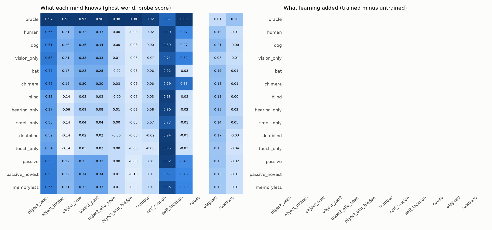
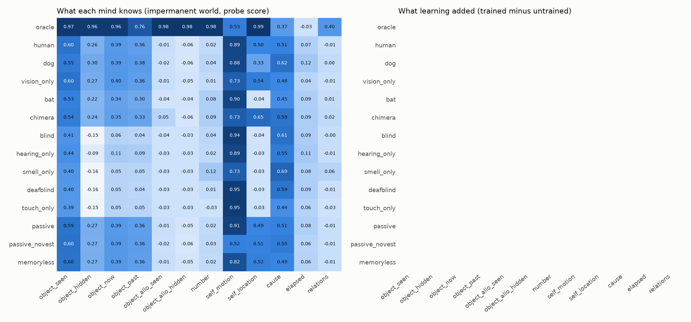
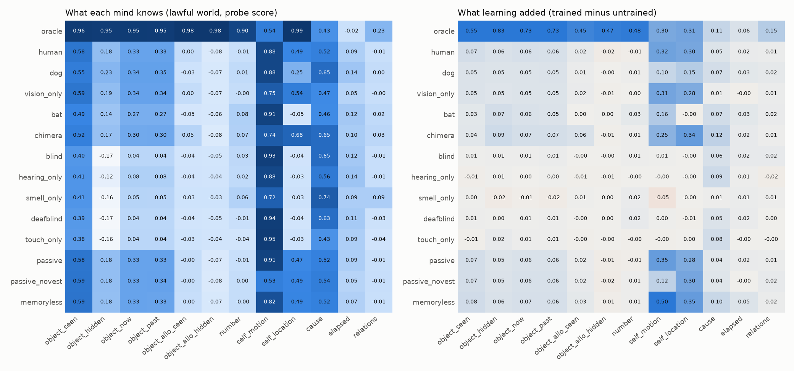
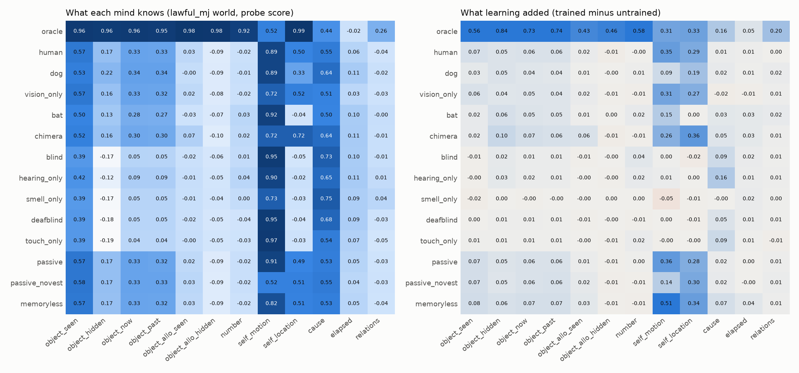
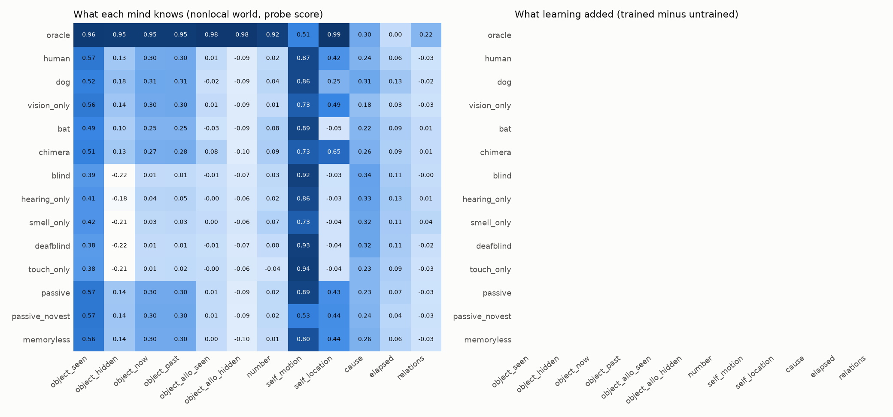
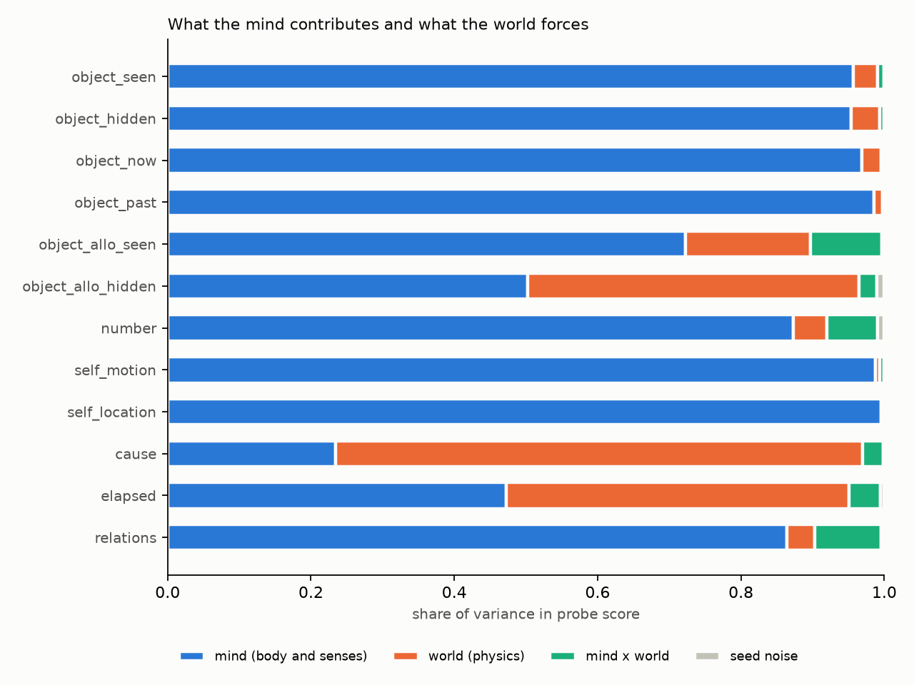
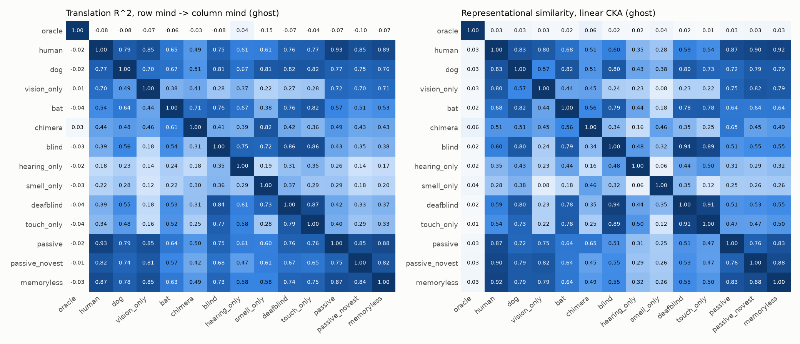
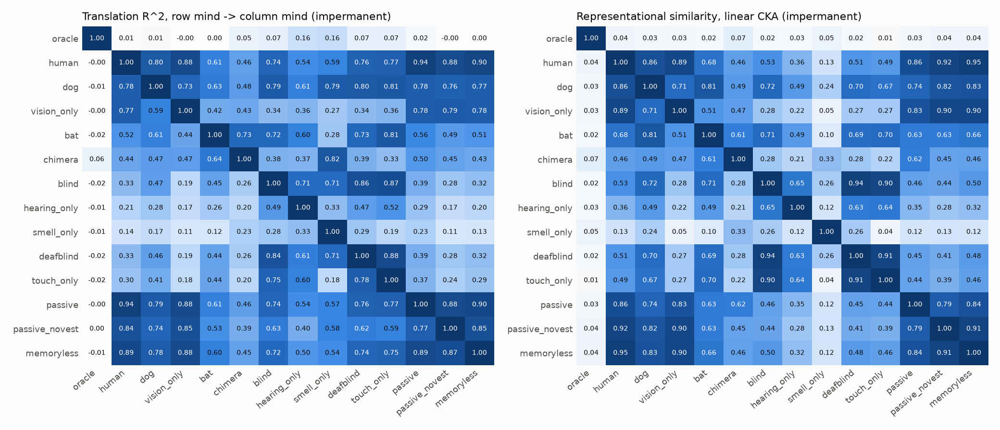
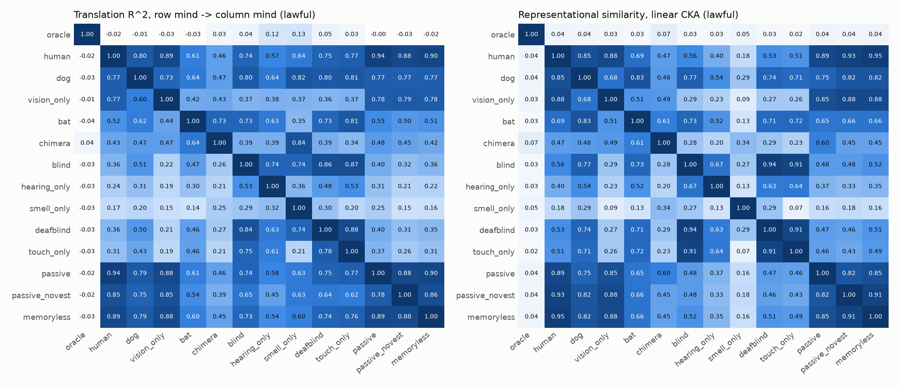
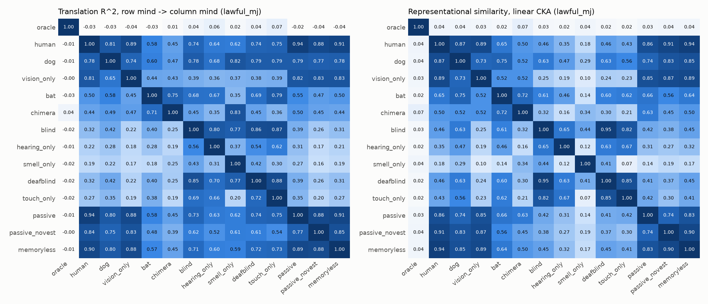
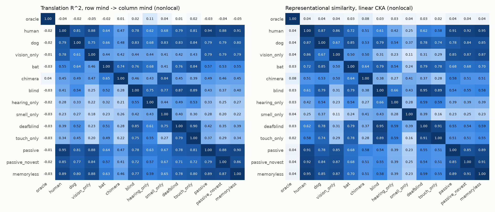
