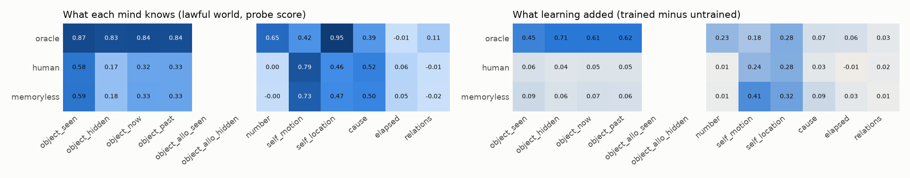
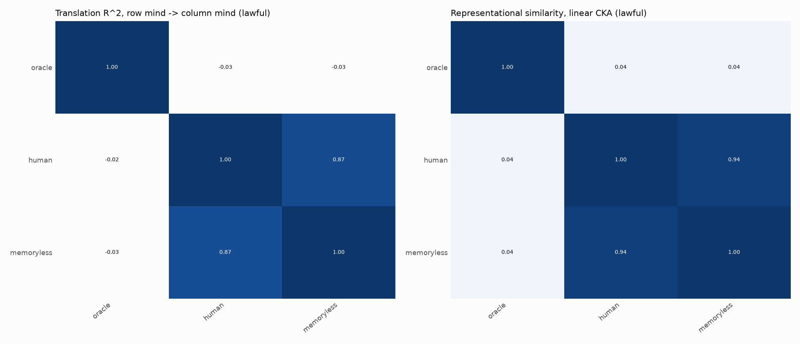

# umwelt results (pilot)

Worlds: lawful. Seeds: 0. Minds per world: 3.

## Preregistered checks

| check | verdict | numbers |
|---|---|---|
| V1 oracle is the ceiling | PASS | exceeded by: none |
| V2 trained beats untrained on 5+ concepts | PASS | fails: none |
| V3 untrained minds show no surprise | FAIL | surprised: oracle/permanence |
| V3 excluding the oracle (not preregistered: the oracle sees the hidden event directly) | PASS | surprised: none |
| H1 permanence needs memory | FAIL | human 0.17, memoryless 0.18, raw 0.17 |
| H6 surprise at impossible permanence | FAIL | interval above 0 for ['human']; memoryless null True; share of minds less surprised after impermanent training n/a |

## lawful world: probe scores (MLP probe; untrained / raw senses / linear probe in brackets)

| mind | object_seen | object_hidden | object_now | object_past | object_allo_seen | object_allo_hidden | number | self_motion | self_location | cause | elapsed | relations |
|---|---|---|---|---|---|---|---|---|---|---|---|---|
| oracle | 0.87 [0.42 / 0.99 / 0.35] | 0.83 [0.12 / 0.98 / -0.20] | 0.84 [0.23 / 0.99 / 0.00] | 0.84 [0.22 / 0.98 / 0.01] | n/a [n/a / n/a / n/a] | n/a [n/a / n/a / n/a] | 0.65 [0.41 / 0.95 / 0.72] | 0.42 [0.24 / 0.52 / 0.08] | 0.95 [0.68 / 1.00 / 0.94] | 0.39 [0.32 / 0.36 / 0.31] | -0.01 [-0.08 / 0.01 / -0.01] | 0.11 [0.08 / 0.12 / 0.15] |
| human | 0.58 [0.52 / 0.57 / 0.51] | 0.17 [0.13 / 0.17 / 0.17] | 0.32 [0.27 / 0.32 / 0.30] | 0.33 [0.28 / 0.32 / 0.29] | n/a [n/a / n/a / n/a] | n/a [n/a / n/a / n/a] | 0.00 [-0.00 / 0.01 / -0.00] | 0.79 [0.55 / 0.79 / 0.67] | 0.46 [0.19 / 0.54 / 0.07] | 0.52 [0.48 / 0.50 / 0.49] | 0.06 [0.07 / 0.03 / 0.08] | -0.01 [-0.03 / -0.02 / 0.00] |
| memoryless | 0.59 [0.50 / 0.57 / 0.51] | 0.18 [0.12 / 0.17 / 0.18] | 0.33 [0.26 / 0.32 / 0.30] | 0.33 [0.27 / 0.32 / 0.29] | n/a [n/a / n/a / n/a] | n/a [n/a / n/a / n/a] | -0.00 [-0.01 / 0.01 / 0.00] | 0.73 [0.32 / 0.79 / 0.64] | 0.47 [0.14 / 0.54 / 0.08] | 0.50 [0.41 / 0.49 / 0.44] | 0.05 [0.02 / 0.03 / 0.08] | -0.02 [-0.03 / -0.02 / -0.00] |

### lawful world: surprise at impossible events (S, 95% interval; copy-baseline S)

| mind | permanence | solidity | causality |
|---|---|---|---|
| oracle | 0.202 [0.187, 0.215] (5027.581) | -0.016 [-0.053, 0.026] (0.000) | -0.012 [-0.016, -0.009] (0.000) |
| human | 0.005 [0.001, 0.009] (0.006) | 0.000 [-0.005, 0.005] (-0.002) | -0.078 [-0.126, -0.033] (-0.001) |
| memoryless | 0.003 [-0.000, 0.006] (0.008) | 0.004 [0.001, 0.007] (0.009) | -0.071 [-0.118, -0.028] (-0.006) |

## Figures

