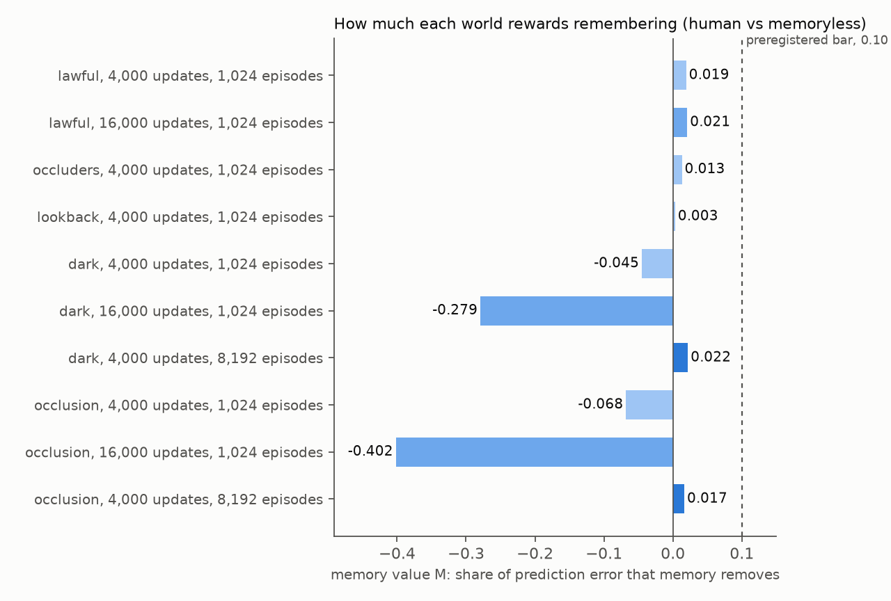
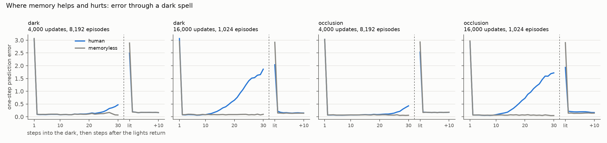
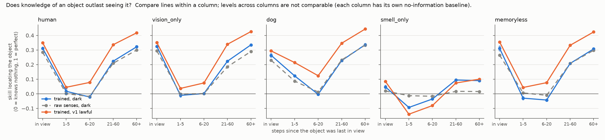
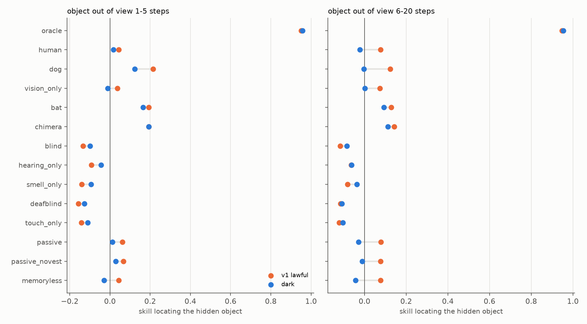
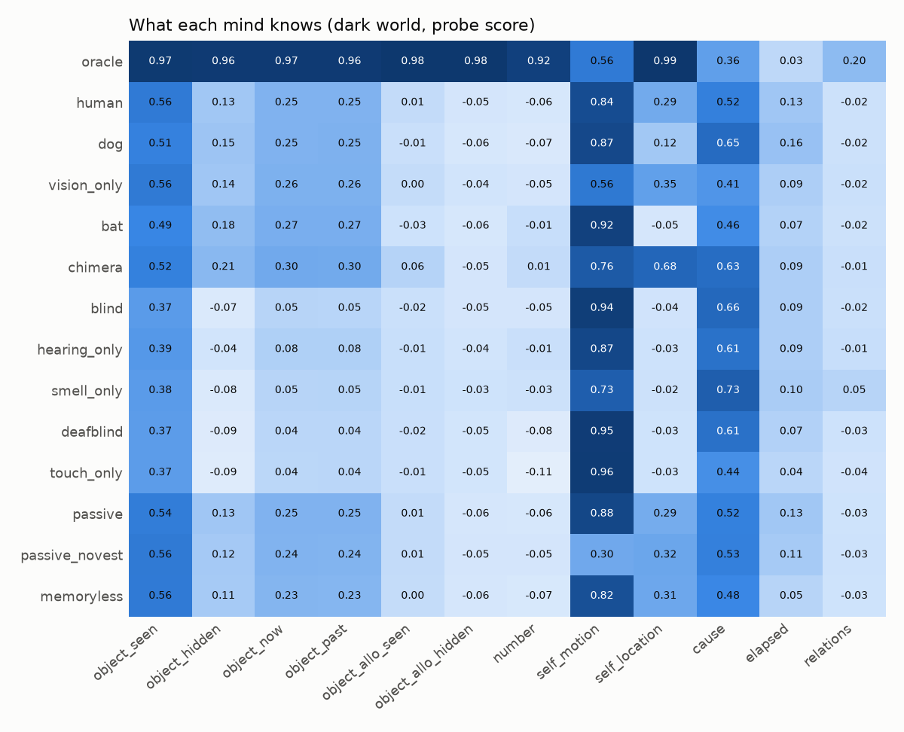
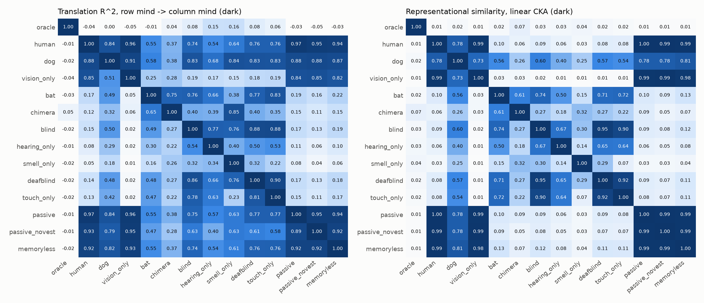

# umwelt v2: a world where remembering pays

Chosen world: **dark**. Preregistration: `docs/preregistration.md`, Amendments 2 to 4 (the design run here is Amendment 4's: 8,192 training episodes, 4,000 updates, and the replacement manipulation check M1). Confirmatory data: data seed 1 (fresh episodes), learner seeds 0 and 1, all minds.

## Calibration (exploratory, picks the world)

Memory value M = 1 - err(human) / err(memoryless): the share of one-step prediction error on held-out episodes that memory removes. Data seed 0, learner seed 0. Only prediction error was looked at. Stage 1 used 4,000 updates (Amendment 2); stage 2 used 16,000 (Amendment 3); stage 3 used 8,192 training episodes (Amendment 4).

| world | M | err human | err memoryless | M on dark steps | M on first lit step | M when an object returns | M on other steps |
|---|---|---|---|---|---|---|---|
| lawful, 4,000 updates, 1,024 episodes | 0.019 | 0.2272 | 0.2317 | n/a | n/a | 0.014 | 0.020 |
| occluders, 4,000 updates, 1,024 episodes | 0.013 | 0.1907 | 0.1932 | n/a | n/a | 0.012 | 0.013 |
| lookback, 4,000 updates, 1,024 episodes | 0.003 | 0.3127 | 0.3137 | n/a | n/a | -0.019 | 0.006 |
| dark, 4,000 updates, 1,024 episodes | -0.045 | 0.2320 | 0.2220 | -0.216 | 0.217 | 0.185 | -0.045 |
| occlusion, 4,000 updates, 1,024 episodes | -0.068 | 0.2347 | 0.2198 | -0.374 | 0.305 | 0.230 | -0.042 |
| lawful, 16,000 updates, 1,024 episodes | 0.021 | 0.1895 | 0.1935 | n/a | n/a | 0.012 | 0.021 |
| dark, 16,000 updates, 1,024 episodes | -0.279 | 0.2652 | 0.2073 | -0.919 | 0.302 | 0.255 | -0.104 |
| occlusion, 16,000 updates, 1,024 episodes | -0.402 | 0.2813 | 0.2007 | -1.041 | 0.334 | 0.228 | -0.328 |
| dark, 4,000 updates, 8,192 episodes | 0.022 | 0.2192 | 0.2241 | -0.028 | 0.136 | 0.106 | 0.010 |
| occlusion, 4,000 updates, 8,192 episodes | 0.017 | 0.2243 | 0.2281 | -0.043 | 0.135 | 0.094 | 0.006 |

## Validation (v1 criteria, in the chosen world)

- PASS V1 oracle is the ceiling: exceeded by: none
- FAIL V2 trained beats untrained on 5+ concepts: fails: smell_only (4/12)
- FAIL V3 untrained minds show no surprise: surprised: oracle/permanence
- PASS V3 excluding the oracle (not preregistered: the oracle sees the hidden event directly): surprised: none

## Preregistered hypotheses (Amendments 2 and 4)

The manipulation check M1 failed, so by Amendments 2 and 4 every hypothesis P1 to P4 below is tested under a weaker manipulation than preregistered.

- FAIL M1 (Amendment 4) memory pays where the world rewards it: M at object returns >= 0.10 and overall M >= 0, each learner seed; the original bar, overall M >= 0.10, failed in calibration: seed 0: M at returns 0.093, overall M 0.016; seed 1: M at returns 0.057, overall M 0.013
- FAIL P1 permanence needs memory (weak manipulation): 1-5 steps: human 0.02, human raw senses 0.00, memoryless -0.03; 6-20 steps: human -0.02, human raw senses -0.02, memoryless -0.04
- FAIL P2 updating a hidden object needs knowledge of own motion (weak manipulation): 6-20 steps: human -0.02, passive_novest -0.01
- FAIL P3 counting needs memory when objects hide (weak manipulation): number: human -0.06, memoryless -0.07
- FAIL P4 surprise at impossible permanence (weak manipulation): human S 0.0008 [-0.0011, 0.0030], S 0.0008 [-0.0013, 0.0029]; memoryless S 0.0003 [-0.0013, 0.0018], S 0.0003 [-0.0011, 0.0018]; human mean S 0.0008 here vs 0.0007 in v1 lawful (all three parts must hold)

## v1 hypotheses re-run in the chosen world (exploratory)

- FAIL H1 permanence needs memory: human 0.13, memoryless 0.11, raw 0.11
- FAIL H2 smell lives in the past: past bias smell 0.002, vision 0.002; smell_only object_now 0.05, so a near-zero bias may be noise
- FAIL H3 Held and Hein: efference shapes self, not objects: self_location human 0.29 vs passive_novest 0.32; self_motion 0.84 vs 0.30; object_seen human 0.56 vs passive 0.54
- FAIL H4 counting needs a sense that separates objects: vision_only -0.05, bat -0.01, smell_only -0.03, hearing_only -0.01
- PASS H5 translation runs from richer to poorer minds: human->blind 0.74 vs blind->human 0.15; human->vision_only 0.96 vs vision_only->human 0.85; dog->smell_only 0.84 vs smell_only->dog 0.18
- FAIL H6 surprise at impossible permanence: interval above 0 for none; memoryless null True; share of minds less surprised after impermanent training n/a

## Permanence decay curves, every mind (mean of learner seeds)

Skill at locating each object relative to the agent, by steps since it was last in view. 0 is a mind that knows nothing (always guesses the kind's average place), 1 is perfect. Comparisons within a column share one baseline; comparisons across columns do not, because objects far from their average place inflate skill. Raw-sense rows do not depend on the learner seed (same data, same probe seed), so each is one measurement.

| mind | in view | 1-5 | 6-20 | 21-60 | 60+ | 1-5 dark | 1-5 lit | 6-20 dark | 6-20 lit |
|---|---|---|---|---|---|---|---|---|---|
| oracle | 0.95 | 0.96 | 0.95 | 0.97 | 0.97 | 0.95 | 0.96 | 0.95 | 0.96 |
| human | 0.31 | 0.02 | -0.02 | 0.22 | 0.32 | 0.05 | 0.00 | -0.05 | -0.00 |
| human, raw senses | 0.28 | 0.00 | -0.02 | 0.21 | 0.30 | -0.03 | 0.02 | -0.06 | 0.01 |
| dog | 0.26 | 0.12 | -0.00 | 0.23 | 0.34 | 0.07 | 0.15 | -0.06 | 0.04 |
| dog, raw senses | 0.23 | 0.09 | 0.01 | 0.23 | 0.33 | -0.05 | 0.15 | -0.06 | 0.06 |
| vision_only | 0.32 | -0.01 | 0.00 | 0.22 | 0.34 | 0.00 | -0.02 | -0.01 | 0.01 |
| vision_only, raw senses | 0.29 | -0.00 | 0.00 | 0.19 | 0.29 | -0.02 | 0.01 | -0.01 | 0.01 |
| bat | 0.22 | 0.16 | 0.09 | 0.28 | 0.33 | 0.17 | 0.16 | 0.06 | 0.12 |
| chimera | 0.26 | 0.19 | 0.11 | 0.30 | 0.37 | 0.24 | 0.17 | 0.11 | 0.12 |
| blind | 0.04 | -0.10 | -0.08 | 0.11 | 0.08 | -0.02 | -0.13 | -0.10 | -0.07 |
| hearing_only | 0.08 | -0.04 | -0.06 | 0.12 | 0.11 | 0.02 | -0.07 | -0.07 | -0.05 |
| smell_only | 0.05 | -0.09 | -0.04 | 0.09 | 0.09 | -0.01 | -0.13 | -0.03 | -0.04 |
| smell_only, raw senses | 0.02 | -0.01 | -0.02 | 0.02 | 0.02 | 0.02 | -0.03 | -0.00 | -0.03 |
| deafblind | 0.03 | -0.13 | -0.11 | 0.11 | 0.09 | -0.03 | -0.17 | -0.12 | -0.10 |
| touch_only | 0.03 | -0.11 | -0.10 | 0.10 | 0.07 | -0.04 | -0.14 | -0.12 | -0.09 |
| passive | 0.30 | 0.01 | -0.03 | 0.23 | 0.33 | 0.05 | -0.01 | -0.06 | -0.01 |
| passive_novest | 0.32 | 0.03 | -0.01 | 0.19 | 0.31 | 0.07 | 0.01 | -0.03 | 0.00 |
| memoryless | 0.31 | -0.03 | -0.04 | 0.21 | 0.31 | -0.05 | -0.02 | -0.07 | -0.02 |
| memoryless, raw senses | 0.26 | 0.01 | -0.01 | 0.21 | 0.30 | -0.01 | 0.01 | -0.05 | 0.02 |

## Probe scores (MLP probes, mean of learner seeds)

| mind | test error | object_seen | object_hidden | object_now | object_past | object_allo_seen | object_allo_hidden | number | self_motion | self_location | cause | elapsed | relations |
|---|---|---|---|---|---|---|---|---|---|---|---|---|---|
| oracle | 0.0723 | 0.97 | 0.96 | 0.97 | 0.96 | 0.98 | 0.98 | 0.92 | 0.56 | 0.99 | 0.36 | 0.03 | 0.20 |
| human | 0.2086 | 0.56 | 0.13 | 0.25 | 0.25 | 0.01 | -0.05 | -0.06 | 0.84 | 0.29 | 0.52 | 0.13 | -0.02 |
| dog | 0.2096 | 0.51 | 0.15 | 0.25 | 0.25 | -0.01 | -0.06 | -0.07 | 0.87 | 0.12 | 0.65 | 0.16 | -0.02 |
| vision_only | 0.1665 | 0.56 | 0.14 | 0.26 | 0.26 | 0.00 | -0.04 | -0.05 | 0.56 | 0.35 | 0.41 | 0.09 | -0.02 |
| bat | 0.2968 | 0.49 | 0.18 | 0.27 | 0.27 | -0.03 | -0.06 | -0.01 | 0.92 | -0.05 | 0.46 | 0.07 | -0.02 |
| chimera | 0.2181 | 0.52 | 0.21 | 0.30 | 0.30 | 0.06 | -0.05 | 0.01 | 0.76 | 0.68 | 0.63 | 0.09 | -0.01 |
| blind | 0.2857 | 0.37 | -0.07 | 0.05 | 0.05 | -0.02 | -0.05 | -0.05 | 0.94 | -0.04 | 0.66 | 0.09 | -0.02 |
| hearing_only | 0.6474 | 0.39 | -0.04 | 0.08 | 0.08 | -0.01 | -0.04 | -0.01 | 0.87 | -0.03 | 0.61 | 0.09 | -0.01 |
| smell_only | 0.0023 | 0.38 | -0.08 | 0.05 | 0.05 | -0.01 | -0.03 | -0.03 | 0.73 | -0.02 | 0.73 | 0.10 | 0.05 |
| deafblind | 0.2528 | 0.37 | -0.09 | 0.04 | 0.04 | -0.02 | -0.05 | -0.08 | 0.95 | -0.03 | 0.61 | 0.07 | -0.03 |
| touch_only | 0.2406 | 0.37 | -0.09 | 0.04 | 0.04 | -0.01 | -0.05 | -0.11 | 0.96 | -0.03 | 0.44 | 0.04 | -0.04 |
| passive | 0.2105 | 0.54 | 0.13 | 0.25 | 0.25 | 0.01 | -0.06 | -0.06 | 0.88 | 0.29 | 0.52 | 0.13 | -0.03 |
| passive_novest | 0.2123 | 0.56 | 0.12 | 0.24 | 0.24 | 0.01 | -0.05 | -0.05 | 0.30 | 0.32 | 0.53 | 0.11 | -0.03 |
| memoryless | 0.2117 | 0.56 | 0.11 | 0.23 | 0.23 | 0.00 | -0.06 | -0.07 | 0.82 | 0.31 | 0.48 | 0.05 | -0.03 |

## Surprise (S, mean of learner seeds; v1 movies)

| mind | permanence | solidity | causality |
|---|---|---|---|
| oracle | 0.973 | 0.002 | -0.028 |
| human | 0.001 | -0.003 | -0.001 |
| dog | -0.001 | -0.001 | 0.002 |
| vision_only | -0.001 | -0.002 | 0.002 |
| bat | -0.000 | 0.007 | -0.067 |
| chimera | 0.001 | 0.011 | -0.049 |
| blind | -0.005 | -0.004 | 0.001 |
| hearing_only | 0.003 | -0.000 | 0.002 |
| smell_only | -0.005 | 0.007 | 0.000 |
| deafblind | -0.001 | 0.005 | -0.006 |
| touch_only | 0.005 | -0.002 | 0.004 |
| passive | -0.000 | -0.003 | -0.004 |
| passive_novest | 0.000 | 0.000 | -0.006 |
| memoryless | 0.000 | -0.002 | -0.003 |

## Figures

